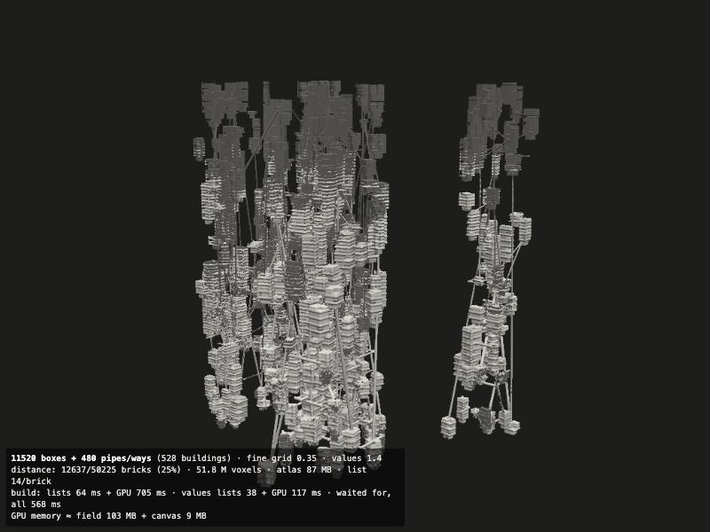
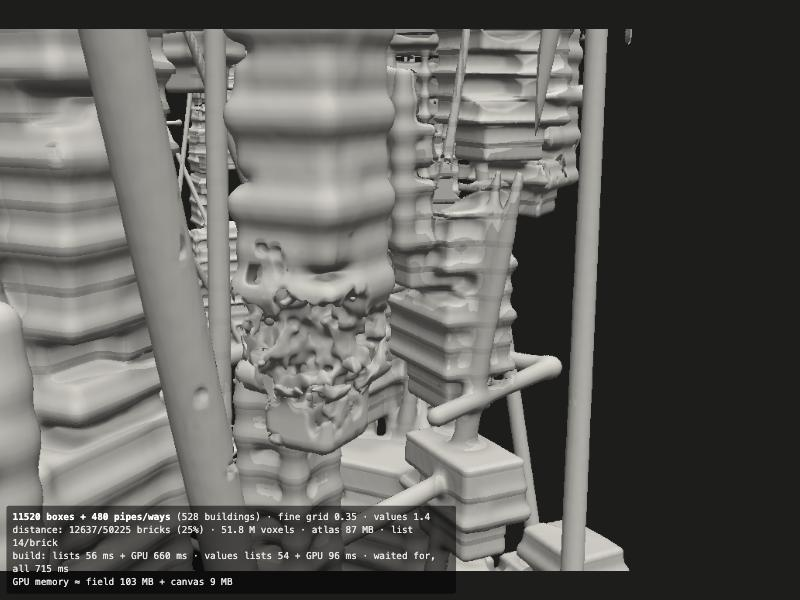
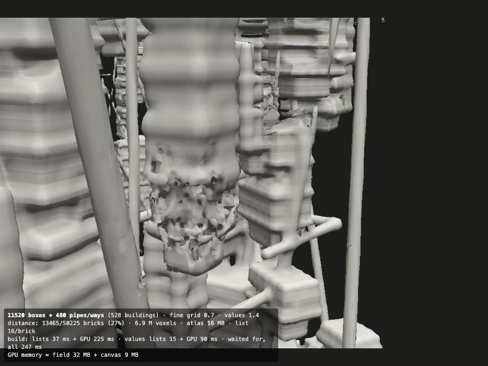

# 화석을 GPU 위의 하나의 장(場)으로 — 시험 결과 (2026-11-18)

작가가 11/18에 다섯 갈래 중 "5 궁금함"이라고 한 것 — 화석을 워커가 조각조각 메시로 만들지 않고, **땅 전체를 하나의 화석 장(field)으로 GPU에 두고 필터가 어디에 보일지 정하게** 하는 것 — 을 따로 만들어 재 본 결과입니다. 벽(`ParliamentSpace.tsx`, `fuse.ts`, `fuseUnits.ts`)은 건드리지 않았습니다.

- 시험 페이지: `apps/web/public/trial/fossil-gpu/index.html` (+ `main.js`, `gen.js`) — Next와 상관없는 정적 페이지
- 볼 곳: 프리뷰 `…/trial/fossil-gpu/index.html` (링크는 맨 아래)
- 조작: 오른쪽 위 패널 — `창의 꼭대기 (단)`를 내리고 올리면 화석이 나오고 삭는 것이 바로 바뀜(비용 없음), `부재 보기`, `격자` 0.35 / 0.7, `상자 하나 바꾸기`. 주소 뒤에 `?res=0.35&n=20000&w=1080&h=1920` 처럼 붙여도 됨.

## 무엇을 만들었나

1. **입력** — 작가 세계의 덤프가 아니라 **만든 블록**입니다: 160×160칸(192 world) × 120단, 마을 9–14개, 건물 ~530채, 상자 11 520개(층마다 latticeUnion처럼 합쳐진 덩어리 1–2개, 두 층마다 판, 지하, 40%의 건물엔 모서리 기둥) + 관·길 480개(캡슐). 2만 개짜리도 재 봄. 각 상자에 단, 굳을 때의 꼭대기(born), 식생 몫, 골조/채움을 붙임.
2. **장** — 공간을 벽돌(16³ 또는 8³ 복셀)로 자르고, **상자에서 1.6 world 안에 드는 벽돌만** 둡니다(전체의 25–29%). 복셀 하나하나를 **GPU가 채웁니다**: 아틀라스(3D 텍스처)를 한 장씩 그리면서, 프래그먼트 셰이더가 그 벽돌 목록의 상자들을 읽어 **매끈한 합집합의 거리**(1바이트)를 씀. 그 옆에 **장소의 값** — 그 자리에서 가장 늦게 굳은 것의 시기(늦은 것에 무게), 식생, 골조/채움 — 을 1.4 world 격자로 따로 둠(지금 `placeValues`가 1 world 격자에 흐리게 펴는 것과 같은 역할).
3. **상자 하나가 바뀌면** — 그 상자의 옛 자리와 새 자리 둘레 벽돌만 목록을 새로 쓰고 그 벽돌 칸만 다시 그림.
4. **그리기** — 기둥의 경계 안에서 광선을 걸음. 빈 벽돌은 건너뜀. 걸음마다 **벽의 나오기 필터를 그대로**(`FUSE_GROW_VERT_BODY`, 작가 값: onset 0.22, full 0.9, 층↔나이 0.5, 40단, 골조 먼저 0.5 / 0.6, 수명 켬 · 0.75 / 0.3 / 60 / 30, 구멍 1, 알갱이 1.2, 들쭉 0.6, 패치 9): 덩어리 = 부재들의 매끈한 합집합을 **나온 만큼 부풀린 것**, 안 나온 곳엔 없음, 수명이 다한 곳엔 같은 노이즈로 **구멍을 뚫음**. 부재(회색 상자)와 깊이를 맞춰 그림.

## 숫자

측정: 이 Mac(M2, 8 GB, Chrome의 ANGLE Metal), 소리 없는 페이지, 탭 하나. **GPU 시간은 GPU의 시계(timer query)로 잰 것** — 같은 GPU에서 작가의 벽과 다른 세션 탭이 같이 돌아서 들쭉날쭉합니다. 처음 두 번은 부하 ~100, 나중 두 번은 부하 ~7–50에서 잰 것이라 범위로 적습니다.

### 장을 만드는 값

| | 지금의 메시 화석 (워커) | GPU 장, 격자 0.7 | GPU 장, 격자 0.35 | GPU 장, 0.35 · 상자 2만 |
|---|---|---|---|---|
| 상자 | 작가 세계 | 11 520 + 관 480 | 11 520 + 관 480 | 19 216 + 관 784 |
| 복셀 | — | 690만 | 5 180만 | 5 670만 |
| **전체를 만드는 데** | **15–35분** (조각 하나 ~2.5 s) | **0.3–0.5 s** (CPU 목록 25–110 ms + GPU 0.25–0.35 s) | **0.4–0.9 s** (CPU 30–60 ms + GPU 0.65–0.8 s) | **1.1–1.5 s** |
| **상자 하나 바뀌면** | 그 조각 다시: ~2.5 s(+ 이웃이 다 될 때까지 보류) | **GPU 4–11 ms** (최대 22), CPU ~1 ms | **GPU ~8 ms** (최대 26), CPU 0.2 ms | GPU 3–6 ms |
| GPU 메모리 | 삼각형 150만 개 (재지 않음; 꼭짓점 속성으로 어림 80–100 MB) | **~32 MB** | **~103 MB** | **~113 MB** |
| JS 메모리 (페이지 전체) | — | 25–31 MB | 47–49 MB | 51 MB |

(밀도로 꽉 채우면 0.35는 813 MB — 이 Mac엔 안 됨. 그래서 벽돌로 성기게 + 값은 굵은 격자로 나눔. 네 채널을 다 0.35에 두면 300–430 MB였음.)

### 한 프레임의 GPU 값 (화석만; 부재 상자는 0.75 ms)

| 창 크기 | 격자 0.7 | 격자 0.35 |
|---|---|---|
| 1033 × 700 | 11–14 ms | 15–18 ms |
| 2000 × 1125 | 16–31 ms | 37–40 ms (2만 개: 23 ms) |
| 세로 1080 × 1920 | 26–68 ms | **77 ms** |
| 2000 × 1125, 절반 해상도 | 8–13 ms | 10–13 ms |
| 세로 1080 × 1920, 절반 해상도 | 13–15 ms | **25–26 ms** (2만 개: 19 ms) |

읽는 법: 30 fps 한 프레임이 33 ms입니다. 벽은 이미 픽셀에 묶여 있으니(10/29 기록: 빈 세계에서도 1033 px 48 fps, 2000 px 16 fps) **이 값은 벽 위에 더해집니다.** 세로 TV에서 0.35를 제 해상도로 그리면 화석만으로 77 ms(≈13 fps) — 안 됨. 화석만 절반 해상도로 그리면 25 ms.

## 그림

전체 기둥, 격자 0.35, 부재와 함께:

가까이, 화석만 — 0.35(위)와 0.7(아래). 가운데 아래쪽이 수명이 다해 구멍으로 먹힌 곳. 0.7은 상자 면에 계단 무늬가 생기고 무름.

(빛과 색은 대충 맞춘 돌 색입니다 — 벽의 레진·돌 재질이 아님. 모양과 무게만 보시면 됩니다.)

## 지금 화석의 모양 중 무엇이 넘어오고 무엇이 안 넘어오나

| 지금의 것 | 장으로 | 메모 |
|---|---|---|
| 부재에서 부풀어 나옴 (seeded, 층·나이·식생으로) | **넘어옴** — 시험에 들어 있음 | 법선 방향으로 물러나는 대신 "나온 만큼 부풀림". 결과가 한 몸으로 움직임(장소의 값). |
| 수명 — 구멍으로 삭음, 패치마다 들쭉날쭉 | **넘어옴, 더 나음** — 시험에 들어 있음 | 메시는 표면에 구멍을 내고 안쪽 뒷면이 보이지만, 장에선 **진짜로 뚫린 3D 구멍**. |
| 골조 먼저, 판·방은 나중 (fuseLate) | **넘어옴(간단히)** — 시험에 들어 있음 | 시험은 "기둥·관 = 골조"로만 셈. 지금처럼 "부재 모서리 가까이 = 골조"로 하려면 값 장에 한 채널 더(싸다). |
| 창 아래 끝에서 부재로 돌아감, 창의 상승 | **넘어옴** | 숫자 하나. 창이 오르면 벽돌 주소를 고리처럼 돌려 아래를 버리고 위를 채우면 됨(시험엔 없음). |
| 껍데기 (안이 빈 shell, 두께) | **넘어옴(쉬움)** | 거리에서 두께를 빼는 한 줄. 시험엔 없음. |
| 갈비 (보로노이 구멍 사이의 rib), 파인 자국(pits) | **넘어옴, 값이 듦** | 셰이더에서 걸음마다 보로노이 계산 → 프레임 값이 늘어남(재지 않음). pits는 음영만이라 지금 코드 그대로. |
| 판 사이 방 채우기 (B FILL, 위 판에서 매달림) | **어려움** | "어느 판 아래 어느 판"을 찾는 구조 연산이라 벽돌 목록만으로는 안 됨. 따로 판 목록을 만들어야 함. |
| 반투명 레진(투과·두께), 그림자 | **다시 만들어야 함** | 광선이 안으로 더 들어가 흡수를 쌓으면 레진처럼 보이지만 걸음이 늘어남. 그림자를 드리우려면 그림자 지도에도 한 번 더 걸어야 함. |
| 조각이 나타날 때 몇 초에 걸쳐 나옴 (growShown) | **필요 없어짐** | 조각이 없음. 바뀐 곳은 다음 프레임에 바로 바뀜(원하면 벽돌마다 시각을 두면 됨). |
| 조각 경계의 열린 단면, 따라잡지 못하는 대기열 | **문제 자체가 없어짐** | 장은 하나이고 전체가 1초 안에 다시 만들어짐. |

## 한계 (이 시험이 답하지 않은 것)

- **작가 세계의 실제 상자가 아님.** 숫자는 만든 블록 1.2만–2만 개로 잰 것. 작가 세계의 에셋 상자 수와 퍼짐이 다르면 벽돌 수와 메모리가 비례해서 달라짐.
- 벽 안에 넣어 본 것이 아님. 벽의 렌더 위에 더했을 때의 fps는 위 표의 GPU 값을 벽의 값에 더해 어림한 것.
- 굳은 시기(born)를 1바이트로 둠 — 창이 수백 단 오르면 창 아래 끝 기준으로 다시 적어야 함(값 장만, ~0.1 s).
- 측정은 다른 탭과 GPU를 나눠 쓰는 중이라 ±50% 흔들림.

## 판단 (작가가 정할 것을 위해)

**조건부로 됨(go-with-conditions).**

- **되는 것**: 만드는 시간 15–35분 → 1초 안팎, 상자 하나 바뀜 2.5 s → 10 ms 안팎. 조각·경계·대기열 문제가 통째로 사라지고, 수명의 구멍은 더 그럴듯해짐. 메모리는 0.35에서 ~100 MB로 지금 메시와 비슷한 크기.
- **조건 1 — 화면 값**: 이 장은 **픽셀마다** 값을 냄. 이미 픽셀에 묶인 벽 위에서 세로 TV 제 해상도로는 안 됨. **화석만 절반 해상도로** 그려 합치는 것이 전제(그러면 0.35 세로 25 ms).
- **조건 2 — 모양을 다시 만들어야 하는 것**: 판 사이 방 채우기, 레진의 투과, 그림자, 갈비는 셰이더로 새로 만들어야 하고, 그만큼 프레임 값이 늘어남. 지금 화석과 **똑같이** 보이게 하는 것이 목표라면 일이 큼. "장이라서 가능한 모양"(진짜 구멍, 한 몸으로 부풀기)을 받아들이면 일이 작음.
- **조건 3 — 실제 세계로 한 번 더**: 작가 세계의 에셋 상자를 덤프해 이 페이지에 넣어 벽돌 수·메모리·프레임을 다시 재야 확정.

## 프리뷰

- 브랜치 `claude/sweet-payne-386f4e` (redesign 브랜치 `8b27eb4` 위)
- 프리뷰: PREVIEW_LINK
