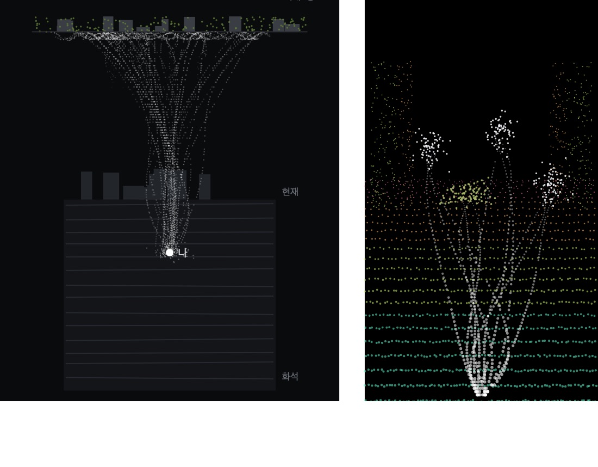
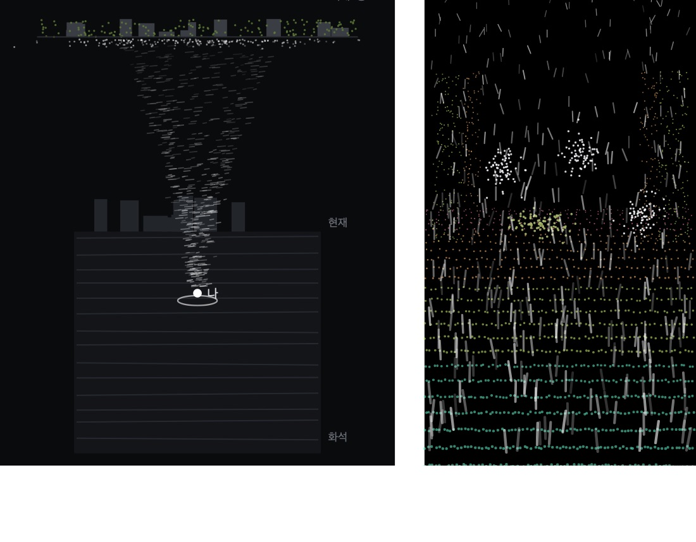
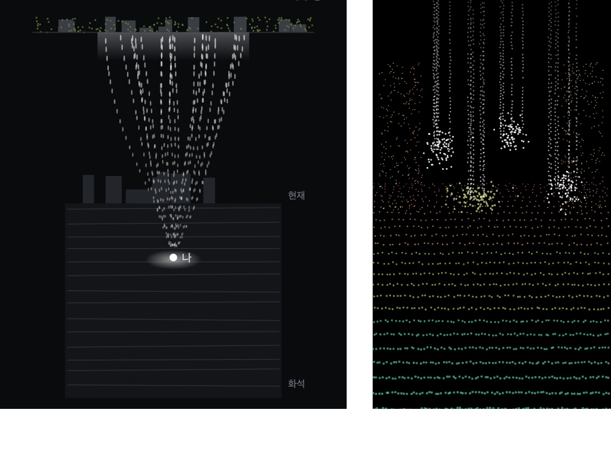

# "나 ↔ 미래": 벽의 '나' 빛기둥과 개인뷰의 미래 응시 (제안, 2026-11-28)

작가(11/28): "개인에서의 미래 응시랑 글로벌의 '나' 빛기둥 더 강하게 미래랑 이어지는 거 (지금처럼 가느다랗고 선명한 에셋보다는
유기적인 느낌을 원함) 효과 제안 및 구현계획".

이 문서는 **고르기 위한 것**이다. 만든 것은 없다(코드 변경 없음). 안마다 벽과 폰에서 보이는 것, 기대는 레퍼런스, 두 곳을 잇는 방법,
프레임당 비용, 구현 계획을 적었다. 그림은 개략 스케치다. 마감은 고른 뒤 레퍼런스 사진과 나란히 놓고 맞춘다.

- 기준: lab 브랜치 `549f686`(scan (future)의 "하나의 만남" 포함).
- 작가 저장값: 벽 `/v2/global/space`, 폰 `/lab/mobile`. 2026-11-28 redesign 프로덕션에서 읽기만 했다.

---

## 0. 세 줄 답

1. 지금 둘은 **이어져 있지 않다**.
   - 벽의 '나' 기둥은 1.2칸짜리 상자이고, 옆면이 칼같이 잘려 있다.
   - 벽의 만남 빛기둥과 폰의 '미래 도착'은 서로 다른 관찰자 수와 다른 규칙으로 따로 계산된다.
2. 세 안 모두 **한 사건을 두 곳에서 같은 몸짓으로** 보여 준다. 사건은 관찰자가 나를 지나는 순간이고, 폰의 잔류가 오는 바로 그 규칙이다.
   - 벽에서는 옆에서 본다: 나 → 위의 미래.
   - 폰에서는 그 몸짓의 한쪽 끝, 내 자리에서 본다.
   - 폰 쪽은 **점으로만** 만들고 잔류의 점은 움직이지 않는다. 11/27에 "억지로 실"을 빼고 떠오름·소용돌이를 0으로 둔 결정을 지킨다.
3. 세 안: **A 실뿌리**(추천) · **B 상승 기류** · **C 스며 내림**. 비용은 셋 다 벽 0.1–0.4 ms, 폰은 만날 때만 0.1–0.2 ms다. 만든 뒤에 잰다.

---

## 1. 지금

**벽의 '나'** (`ParliamentSpace.tsx` MeMark, 2789–)

- 작가 저장값: 나의 표시 = 빛기둥, 흰색, 내 박자로 깜빡임, 시험(블록 가운데 높이) 켬.
- 생김새: 1.2 × 1.2 상자 하나. 밝기는 높이에 따라서만 변한다(내 높이에서 0.65, 꼭대기에서 약 1/3).
- 길이: 내 높이에서 미래 층의 땅(`futureGround.y`, 11/27 dc25b42)까지.
- 옆면은 상자의 면 그대로라 **경계가 칼같이 선다**.
- 전시 카메라 거리 157.5에서 폭은 약 20 px. 이것이 "가느다랗고 선명한" 그 모양이다.
- 미래 층(저장값): 켬, 간격 27단. 파인 상자 6번, 곧 검은 천장 아래 회색 빛 `#555758`, 감쇠 40.5.

**벽의 만남** (`FutureExcavatorsWall.tsx`)

- 발굴자가 관객의 자리를 4 안으로 지나면 빛판 두 장(폭 0.9)이 6 s 선다. 관객 누구에게나 선다.
- 폰과 어긋나는 점:
  - 발굴자 수: 기본 7 / 폰 저장값 6.
  - 다시 오는 간격: 쌍마다 20 s / 폰 60 s.
  - 머무는 시간: 6 s / 폰 '관찰자가 떠난 뒤 10 s'.
- 그래서 벽에 빛판이 설 때 폰에 미래가 온다는 보장이 없다.

**폰의 미래 응시** (`FutureResidue.tsx`, 549f686)

- 작가 저장값: 관찰자 모드, 관찰자 6, 반경 44, 4 안, 최소 60 s, 떠난 뒤 10 s.
- 관찰자가 오면 세 가지가 함께 온다.
  - 스캔이 닿은 자리부터 미래의 남은 것이 현상된다.
  - 안내 문구 "미래가 당신을 응시합니다…"가 뜬다.
  - 백일몽 소리가 난다.
- bot (present)가 이 첫 10–20 s를 '나만의 시간'으로 만드는 중이다(타인 흐려짐, 상호작용 끊김).
- 비어 있는 것: 미래가 **나를** 본다는 몸짓이 화면에 없다. 미래는 주위에 나타날 뿐, 나와 이어지는 형상이 없다.

---

## 2. 세 안 모두에 깔리는 것

1. **한 사건.** '만남'은 폰의 잔류 도착 규칙이다(같은 관찰자 `excavatorsAt`, 4 안, 최소 60 s, 떠난 뒤 10 s).
   - 같은 순수 함수로 **벽도 똑같이 계산**한다. 발굴자는 세계 시계만의 함수라 보낼 것이 없다.
   - 전시 단상에서는 노트북 개인뷰와 벽 모니터가 같은 브라우저다. 벽의 '나' = 그 관객이므로, 관객은 같은 순간을 두 화면에서 본다.
   - 벽의 시험 대역(마커 › 시험)에게도 만남이 생긴다. 그래서 폰 없이 벽만으로 판단할 수 있다.
2. **두 상태.**
   - 평소: 내가 사는 동안 늘 있되 옅고, 내 멜로디의 박자로 숨 쉰다. 지금의 깜빡임을 그대로 쓴다.
   - 만날 때: 부풀어 미래 층 안으로 뻗는다. 폰에 잔류가 머무는 동안(떠난 뒤 10 s까지) 그렇다.
   - 가장 센 때는 첫 10–20 s, 곧 bot (present)의 '나만의 시간'이다.
3. **무채색.** '나'의 것이므로 흰색·회색이다. 미래의 식생은 제 색 그대로 둔다.
4. **점으로만.**
   - 폰: 11/27 결정(실 제거, 떠오름·거리·소용돌이 0)대로, 스캔과 같은 둥근 점으로만 만든다. 잔류와 따로 그리고 잔류의 점은 건드리지 않는다. `FUTURE_LAYER`에 그려 미래의 흐림 규칙을 따른다.
   - 벽: 수직선은 건물의 말이므로(11/22 me-marker §1-2) 벽도 선이 아닌 점·알갱이로 만든다.
5. **소리와 같은 쪽.** 연결은 관찰자가 선 쪽에서 온다. 백일몽 소리가 들려오는 쪽(`futureCue` panFrom)과 같다. 소리 파일은 읽기만 한다.
6. **스위치.**
   - 벽: `마커 › 나의 표시`에 새 선택지를 넣는다. 빛기둥은 비교용으로 남긴다. 작가가 고르고 저장할 때까지 기본은 그대로다.
   - 폰: 잔류가 도는 곳(lab 페이지, `/rehearsal/experiment`, `newLook()`)에서만 보인다. 옛 전시 개인뷰는 그대로다.

---

## 3. 안

### 안 A · 실뿌리: 내 자리에서 미래의 남은 것까지 (추천)

**레퍼런스**

| 그림 | 가져올 것 |
|---|---|
| 벽 `17.jpg` | 투명 판 여러 장을 실 다발이 꿰뚫는다. 맨 아래는 엉킴, 가운데는 느슨한 허리, 위 판에서는 뿌리·물길처럼 갈라져 퍼지고, 실 위에 꽃이 핀다. **층이 쌓인 투명 블록을 유기적인 다발이 잇는다** — 벽의 구조와 같다. |
| 벽 `18.jpg` | 과거·미래·유토피아 판을 잇는 줄. |
| `maxresdefault.jpg`, TD 릴 | 점이 흐름을 따라 머리카락 같은 섬유가 된다. 11/23 결정 "점이 움직일 때 = 섬유"와 같다. |

**벽 — 평소**

- 상자가 없어진다. 대신 작은 점이 위로 흐르는 **섬유 30–40가닥**이 선다(수액이 오르듯).
  - 시작: 내 둘레의 작은 엉킴.
  - 가운데: 느슨한 허리(약 2칸).
  - 위: 미래 층의 땅 아래에서 뿌리 그물로 갈라져, 내 자리 **바로 위의 남은 것**(층에 실제로 있는 부재·둔덕, `futureLink.result`)까지 약 10칸 퍼진다.
- 가닥마다 제 위상으로 천천히 흔들리며 겹쳤다 갈라진다.
- 밝음은 가장자리가 아니라 **겹침**에서 나온다. 전체 밝기는 지금 기둥만큼이되 폭은 3–6배이고 부드럽다.

**벽 — 만날 때**

- 관찰자 쪽부터 가닥이 3배로 늘고, 흐름이 빨라진다. 박동 하나가 약 2 s에 나에서 위로 올라간다.
- 위의 남은 것에서 **가는 뿌리가 내려와** 마중 나온다(미래가 되잡음).
- 폰의 잔류가 머무는 동안 유지된다. 잔류가 흩날릴 때 늘어난 가닥이 아래부터 풀린다.

**폰 — 만날 때**

- 같은 뿌리 그물을 내 발밑에서 평면으로 본다. 스캔된 땅 위로, 내 발밑에서 찾아진 부재 하나하나까지 **점의 잎맥**이 뻗는다.
  - 곧은 선이 아니라 뿌리의 길로 갈라지고 흔들린다. 점은 바깥쪽으로 흐른다.
  - 부재는 잎맥이 닿은 자리부터도 현상된다(스캔이 닿은 자리부터는 지금처럼).
  - 관찰자 쪽 잎맥이 먼저 뻗는다.
- 머무는 동안 잎맥은 옅게 흐른다. 놓아 줄 때는 흐름이 멎고, 내 쪽 끝부터 사라진 뒤 잔류가 흩날린다.
- 하늘 쪽 요소는 없다.

**잇는 것:** 한 그물이다. 양쪽이 같은 규칙으로 같은 닻(내 근처에서 찾아진 남은 것)을 고르고, 갈라지는 씨앗도 같다.
- 벽은 옆에서 본다: 세로 = 시간, 나 → 미래.
- 폰은 같은 뿌리의 윗부분을 발밑에서 본다: 가로 = 자리.

**비용** (추정, 만든 뒤 잰다)

| | 무엇 | GPU / CPU |
|---|---|---|
| 벽 | 점 드로우 하나: 40–120가닥 × 약 150점 = 6–18k점. 위치는 (가닥, t, 시간)으로 정점 셰이더에서 계산하므로 프레임당 CPU 일은 없다. 점 1–2 px라 채움이 작다. | 1080×1920 dpr 1에서 ≤ 0.2 ms |
| 벽 | 닻 찾기: 새 미래 결과가 올 때만(부재 ≤ 12k). 매 프레임이 아니다. | < 1 ms |
| 폰 | 머물 때만: ≤ 12 잎맥 × 120점 ≈ 1.5k점. 잔류 약 109k점의 1.4 %. | 0.05–0.1 ms, 그 밖에는 0 |

**위험**

- 섬유는 가는 것이다. 수와 겹침이 모자라면 다시 '가는 선'이 된다. 그래서 기본값을 다발이 **부드러운 덩어리**로 읽힐 만큼 둔다.
- 폰의 점 잎맥이 11/27에 뺀 '실'을 떠올리게 할 수 있다. 그때의 실은 움직이는 점이 남긴 선이었고, 이것은 땅 위의 점이다. 그래도 실로 읽히면 폰 쪽은 "현상이 내 발밑에서부터 번짐"으로 줄인다.

### 안 B · 상승 기류: 나를 감싸고 오르는 빛 알갱이

**레퍼런스**

| 그림 | 가져올 것 |
|---|---|
| GIF `9392DCD1` | 몸 둘레를 도는 빛의 가로 결이 종 모양의 부피를 이루고, 발밑에 밝은 고리가 있다. |
| GIF `EDEFE77C` | 어깨 위로는 반짝임만 남아 오르며 옅어진다. |
| `ec7dca59…jpg` | 빽빽한 둥근 점의 소용돌이. |
| `IMG_1575` | 넘친 빛. |

**벽 — 평소**

- 빛 알갱이가 내 축을 느슨한 나선으로 돌며 오른다. 알갱이마다 궤도를 따라 짧은 결이 있다(9392의 가로 결).
- 나에게서 빽빽하고 위로 갈수록 성기며 기둥이 넓어진다.
- 미래 층의 땅 아래에서 퍼져 꽃가루처럼 그 밑면에 내려앉는다.
- 폭은 경계가 아니라 흩어짐이다. 내 멜로디의 박마다 궤도가 조금 빨라진다.

**벽 — 만날 때**

- 기류가 빨라지고 열린다. 알갱이가 늘고 기둥이 넓어지며, 발밑 고리가 한 번 켜진다(9392).
- 미래의 땅에서 알갱이가 내 위의 남은 것 위로 퍼진다. 그 뒤 원래 빠르기로 돌아온다.

**폰 — 만날 때**

- 나는 기류의 밑동에 서 있다. 내 둘레의 스캔된 땅에서 알갱이가 떠올라 화면 위로 천천히 빠져나간다.
- 가까운 것은 크고 부드럽다(잔류의 점과 같은 결). 첫 10–20 s에 가장 세고 점점 성기며, 놓아 줄 때 멎는다.
- 잔류 자체는 그대로다.

**잇는 것:** 한 기류다. 벽에서는 나에서 미래까지 오르고, 폰에서는 내가 그 밑동 안에 있다.

**비용** (추정)

| | 무엇 | GPU |
|---|---|---|
| 벽 | 상태 없는 GPU 점 3–5k개 + 3탭 결(정점 9–15k), 더하기 혼합. 기둥이 넓어 A보다 채움이 크다. | 0.2–0.4 ms |
| 폰 | 머물 때만 알갱이 ≤ 2k | 0.1–0.2 ms |

**위험**

- 실루엣이 지금 기둥(세로 빛 덩어리)과 가장 가깝다. 움직임으로 유기적이지만 '파티클 효과'로 읽힐 수 있다.
- 폰에서는 오르는 소용돌이다. 11/27에 잔류의 흩날림을 떠오름·소용돌이 0으로 둔 직후라, 다른 요소이긴 해도 같은 것으로 느껴질 수 있다.

### 안 C · 스며 내림: 미래가 나에게로 흘러내림

**레퍼런스**

| 그림 | 가져올 것 |
|---|---|
| `IMG_1589 / 1597 / 1599` | 그림의 세로 줄이 흘러내린다. 11/22 "세로로 흘러내림이 흥미로움". |
| `images (2).jpeg` | 숲 스캔 속 세로 빛줄기. |
| 벽 `18.jpg` | 위 판에서 아래로 늘어진 줄. |
| 벽의 파인 상자 6번 | 미래 층에서 내려오는 빛(11/17 "핀조명"). |

**응시의 방향이 미래 → 나다.** "미래가 당신을 응시합니다"를 그대로 그린다. 벽의 문법과도 맞다: 위의 것이 아래로 쌓인다(기둥은 퇴적이다).

**벽 — 평소**

- 내 자리 위의 남은 것에서 점의 줄기가 천천히 흘러내린다.
- 미래 층 밑면을 떠날 때는 가늘고, 떨어지며 방울로 맺히고, 나에게 다가올수록 느려지고 성겨진다.
- 내 자리에 작은 빛 웅덩이로 고인다. 나 자신의 빛은 둘레의 짧은 번짐뿐이다.

**벽 — 만날 때**

- 방울이 쏟아짐이 된다. 내 위 미래 층 밑면이 밝아진다(파인 상자 빛을 국소로, 작가의 빛 색).
- 웅덩이가 넓어지고, 그 뒤 다시 방울로 돌아간다.

**폰 — 만날 때**

- 관찰자 쪽 화면 위에서 점의 세로줄이 미끄러져 내려온다(1589의 정렬된 줄을 점으로).
- 줄은 찾아진 부재에 내려앉고, 부재는 줄이 닿은 자리부터 현상된다. 머무는 동안 천천히 계속 듣는다.
- 놓아 줄 때 줄이 끊기고, 잔류 자신의 녹아내림(글리치 세로 흘러내림)이 이어받는다. 아래로 흐르는 하나의 흐름이다.

**잇는 것:** 같은 줄기다. 벽에서는 미래 층에서 나에게로 떨어지고, 폰에서는 검은 하늘에서 내 둘레의 남은 것 위로 떨어진다.

**비용** (추정)

| | 무엇 | GPU |
|---|---|---|
| 벽 | ≤ 64줄기 × 16방울 ≈ 1k 인스턴스 줄. 닻은 A와 같다. | < 0.1 ms (가장 쌈) |
| 폰 | 머물 때만 ≤ 800줄 | < 0.1 ms |

**위험**

- '흘러내림'은 이미 떠남의 말이다(11/22, 잔류의 놓아 줌 글리치). 오는 것과 가는 것이 한 움직임을 나눠 쓰게 된다.
- 벽의 '나'가 수동적이 된다(미래가 하고 나는 받는다). "'나' 빛기둥이 미래로 이어지는"에는 내 쪽의 뻗음이 필요할 수 있다.

---

## 4. 추천

**A 실뿌리.**

- 레퍼런스 17은 벽의 구조 자체다. 시간이 쌓인 투명 블록을 유기적인 다발이 꿰뚫는다. 연결의 몸이 **경계가 아니라 수와 겹침**에서 나온다.
- 실제로 남을 것(내 위, 내가 사라진 뒤 발견될 것)에 닿는다.
- 만날 때 양방향이다. 미래에서 내려오는 뿌리가 C의 '응시'를 A 안에 넣는다.
- 폰에서는 잔류에 없던 몸짓(**나에게서** 뻗음)을 더하면서 잔류의 점은 건드리지 않는다.

다른 경우:
- 그물보다 **빛의 부피**를 원하면 B.
- **미래가 행하는 쪽**이길 원하면 C.
- 섞을 수 있다(예: 벽 A + 폰 C). 다만 '같은 몸짓'은 약해진다.

---

## 5. 구현 계획

순서: **벽 먼저**(작가가 시험 대역으로 자기 벽에서 바로 판단), 그다음 폰. 한 단계마다 작가 확인.

### 5.1 공통 (어느 안이든 같은 파일)

1. **`lib/parliament/meFutureLink.ts`** (새 파일, 순수 함수)
   - 만남 규칙: 관찰자 = `excavatorsAt` + lab의 수·반경·구간, 4 안, 최소 60 s, 머무름 = 잔류의 남는 시간.
   - 닻: 내 근처의 남은 것을 고정된 순서로 골라, 벽과 폰이 같은 것을 고른다.
   - 가닥·줄기의 씨앗.
2. **벽 `components/parliament/MeFutureLink.tsx`** (새 파일)
   - '나'의 연결과 만남을 그린다. MeMark가 새 '나의 표시'일 때 띄운다.
   - 미래 층의 땅·남은 것은 `futureGround.y`와 `futureLink.result`에서 읽기만 한다.
3. **벽의 다른 관객**: `FutureExcavatorsWall`의 만남이 1.의 규칙을 쓰게 한다(수 6, 60 s, 머무름). 그러면 벽에 빛판이 설 때 = 그 폰에 미래가 올 때다. 빛판의 모양은 그대로 두고, 같은 몸짓의 작은 판은 나중에 고른다.
4. **폰 `components/parliament/FutureGaze.tsx`** (새 파일): RoleField가 FutureResidue 옆에 띄우고, `FUTURE_LAYER`에 그린다.
5. **FutureResidue에서 받을 것** (scan (future)의 파일)
   - 읽기 전용 `residueLink` = { 머무는 중, 도착 시각, 놓아 준 시각, 나, 관찰자, 찾아진 부재의 중심 ≤ 32 }.
   - A·C는 하나 더: `developFrom(부재, x, y, z, 시각)`. 부재가 잎맥·줄기가 닿은 자리부터 현상되게 한다.
   - 약 30줄. 그 세션이 하거나, 그 세션의 동의를 받아 한다.
6. **검사**
   - 타입 체크 + 컴파일(작가가 화면을 보며 고치는 동안의 규칙).
   - 캡처: Chrome for Testing `--headless=new --mute-audio`, 내 빈 포트와 프로필, 한 번에 하나, 끝나면 닫는다.
     - 벽: 작가 저장값 + 시험 대역 + 만남 시험 키.
     - 폰: `/lab/mobile/scan-future?botserver=0&futurepass=1`.
     - 레퍼런스(A: 17 · B: 9392 · C: 1589)와 나란히 놓는다.
   - 그다음 작가가 **자기 벽에서** 스위치로 본다. 회색 시험 페이지는 쓰지 않는다.
7. **올리기**: 내 브랜치에 커밋 → lab 채팅에서 작가의 "올려" = lab 브랜치·프리뷰. redesign은 취합 채팅에서 작가의 "올려"일 때만.

### 5.2 Leva (자산의 그룹 안, 적게)

| 안 | 벽: `마커 › 나 ↔ 미래` | 폰: `scan (future) · 미래의 장소 › 미래의 응시` |
|---|---|---|
| A | 세기 · 가닥 수(평소) · 만날 때 × · 위에서 퍼지는 폭(칸) · 흔들림 | 세기 · 잎맥 수 · 뻗는 시간 |
| B | 세기 · 알갱이 수 · 위의 폭 · 오르는 빠르기 · 도는 정도 | 세기 · 알갱이 수 |
| C | 세기 · 줄기 수 · 떨어지는 빠르기 · 웅덩이 크기 | 세기 · 줄 수 · 내려오는 시간 |

색 노브는 없다(무채색 고정). 만남 규칙의 숫자는 노브로 두지 않고 잔류·발굴자 쪽의 기존 값을 읽는다(한 숫자는 한 곳에).

### 5.3 다른 세션의 파일: 어디를 얼마나

| 파일 | 주인 | 바뀌는 것 | 크기 |
|---|---|---|---|
| `ParliamentSpace.tsx` | 공유(벽) | `나의 표시`에 선택지 하나 + MeMark에서 MeFutureLink 띄우기 | ~10줄 |
| `FutureExcavatorsWall.tsx` | 벽의 미래 | 만남을 공통 규칙으로. 새 표시일 때 '나'의 빛판은 건너뜀 | ~15줄 |
| `FutureVillage.tsx` | 벽의 미래 층 | 없음(이미 내보낸 것을 읽기만) | 0 |
| `FutureResidue.tsx` | scan (future) | `residueLink` 내보내기 (+A·C는 `developFrom`) | ~30줄, 동의 필요 |
| `labKnobsScanFuture.ts` | scan (future) | `미래의 응시` 폴더를 그 그룹에 넣기 | 2줄 |
| `RoleField.tsx` | 공유 | FutureGaze 띄우기 | 1줄 |
| `lib/sound/futureCue.ts` | sound | 없음(`onFutureCue`의 panFrom을 읽기만) | 0 |
| bot (present) · bot (future)의 파일, `LidarScan.tsx` | 각 세션 | 없음. B는 `lidarTap`을 읽기만 | 0 |

### 5.4 안마다 안쪽이 다른 것

**A**
- 벽: 섬유 곡선(나 → 허리 → 닻) + 흔들림 노이즈 + 땅 밑 갈래. 흐름은 곡선 위 t가 시간으로 나아감.
- 폰: 땅 위 2D 곡선(나 → 닻)을 따라 점을 놓고 바깥으로 흐름. 끝에서 `developFrom`.

**B**
- 벽: 상태 없는 나선 알갱이. 미래 땅 밑에 내려앉음.
- 폰: 내 가까운 땅의 스캔 판독(`lidarTap`) 또는 내 둘레의 고리에서 알갱이가 오름. `developFrom` 필요 없음.

**C**
- 벽: 닻 → 나로 떨어지는 방울 줄기. 미래 땅 밑에 국소 밝음(파인 상자의 빛 색, 작은 사각 하나).
- 폰: 화면 위 → 각 닻으로 떨어지는 점의 세로줄. 닿는 자리에서 `developFrom`.

---

## 6. 작가에게 묻는 것

1. 어느 안 (A / B / C, 또는 섞기)?
2. 연결이 평소에도 옅게 있어야 하나, 아니면 만날 때만 있어야 하나? 제안은 평소에 옅게 + 만날 때 부풂이다.
3. 다른 관객(원격 폰)의 만남도 같은 몸짓의 작은 판으로 할까, 지금의 6 s 빛판으로 둘까?
