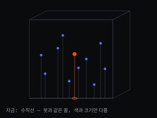
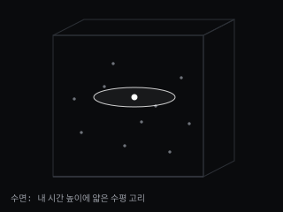
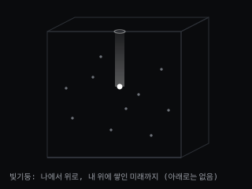
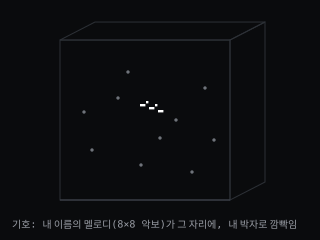
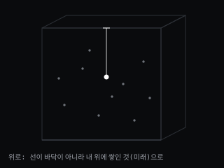
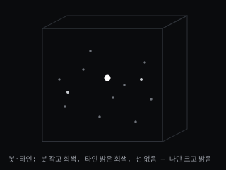

# 벽에서 "나"를 찾는 법 — 제안안 (2026-11-22)

작가(11/22): "글로벌뷰에서 뭐가 '나'인지 모르겠어서, 마커가 아래까지 수직선으로 이어지는 대신 다른 좋은 방법이 있는지,
다른 비주얼 추천에는 뭐가 있고 봇/타인들과 '나' 플레이어 차별화를 어떻게 하면 좋을지 작품 전체 비주얼 고려해서 제안안 만들어."

이 문서는 **고르기 위한 것**이다. 안마다 작은 그림과 한 줄 느낌, 바뀌는 것, 봇·타인과의 구별, 비용, 작가의 규칙과의 관계를 적었다.
상위 안들은 실제 벽의 Leva(`마커` 폴더)에 **스위치**로 들어 있어 자기 건물이 있는 벽에서 바로 켜 볼 수 있다(§4). 기본값은 지금의 수직선이다.

---

## 1. 지금 벽은 "나"를 어떻게 그리나 — 그리고 왜 안 읽히나

코드(`ParliamentSpace.tsx` `Markers`)와 작가의 11/20 저장값(`.leva-live/tab-mwosznc2.json`: 전시 카메라 거리 75 · 높이각 58° · 초점 높이 −25,
시간축 1단 = 20 s, 봇 깊이 45단)으로 벽을 1080×1920(세로)로 떠서 봤다(소리 끔, 창 없는 Chrome).

| | 나 | 봇 | 타인(원격 관객) |
|---|---|---|---|
| 모양 | 공 r 0.5 + **바닥까지 가는 선**(r 0.03) + 바닥 고리 | 공 r 0.32 + 같은 선 + 같은 고리 | 같음 |
| 색 | 주황 `#ff4d00` | 파랑 `#2a62ff` (성격별 색을 켜면 파·주·초·회) | **`#111111`** |
| 멈추면 | 6 s 뒤 흐려짐(0.4)·계속 남음 | 6 s 뒤 사라짐 | 6 s 뒤 사라짐 |
| 판정 | 이 브라우저의 플레이어 탭이 localStorage에 쓴 id | id가 `bot`으로 시작 | 그 밖 |

작가의 카메라(거리 75, 세로 1920 px)에서 월드 1 = 약 **35 px**: 나의 공은 지름 ≈ 35 px, 봇은 ≈ 22 px, 선은 ≈ 2 px.

**안 읽히는 이유 (본 것)**

1. **모두 같은 문장이다.** 공·선·고리 — 봇 25개와 나는 같은 꼴이고 색과 지름 13 px만 다르다. 멀리서 보면 선 4–600 px가 가장 큰 요소인데, 그 선이 전부 같다.
2. **선은 이미 다른 것의 말이다.** 봉인된 슬라브 칸의 수직선(`Marks.tsx` ConcreteLines), 철골 기둥, 배관 — 벽의 수직선은 건물의 어휘다. 마커의 선은 그 사이에 섞인다.
3. **주황은 식생 속에 묻힌다.** 지금 식생 점이 노랑-연두라 주황 공은 "따뜻한 점 하나 더"가 된다. 색은 자연에만 쓰기로 한 규칙과도 어긋나 있다(마커 색은 10/28의 디버깅 표식이 남은 것).
4. **타인은 검정 바탕에 검정이다.** `#111111`은 배경 `#0a0b0d`와 같다 — 원격 관객은 지금 벽에 **안 보인다**.
5. **카메라는 내 시간만 따라간다.** 따라가기는 y(시간 높이)만 옮기고, 바라보는 자리는 `camLook` (0, 0) 고정이다. 내가 마을 하나 건너(40 월드) 서 있으면 나는 화면 가장자리거나 밖이다. 거기에 초점 높이 −25: 카메라는 내 **25단 아래**(화석)를 보고 있어 현재 층은 화면 가운데에 없다. 캡처에서는 살아 있는 마커 25개 중 **3개만** 화면에 들었고 모두 아래 가장자리였다.
6. **멈추면 흐려지기만 한다.** 삶이 끝나도 같은 공이 흐리게 남는다 — 끝의 표식(홀씨, 표본)과 이어지지 않는다.
6-1. **오늘의 세계에서는 카메라가 블록 위 허공을 본다.** 캡처 때 최신 표본은 s 2280(= 높이 114)인데 블록 꼭대기는 31이었다 — 따라가기가 그 표본을 좇아 블록보다 80단 위에 떠 있었다. 관객을 블록 시간 안에 앉히는 고침(life-recording → future-presence 세션)과 함께 풀릴 일이지, 표식의 문제는 아니다. 표식의 '위로'·'기둥'은 블록의 꼭대기(`stats.top`)까지만 간다.
7. 폰·원격 관객은 벽을 못 보니 그들에게 "나"의 문제는 없다. 벽의 "나" = **전시장 기계의 플레이어 탭**(같은 브라우저) — 이 규칙은 이미 코드에 있다. 그러니 "나"는 **전시장 관객 한 사람**을 위한 표식이면 된다. 원격 관객은 "타인"으로 보이기만 하면 된다.

> 캡처: `docs/img/me-marker/wall-2026-11-22.png` (작가의 값, ui=0, 봇 하나를 "나"로 가장).

---

## 2. 제안안

그림의 약속: 회색 작은 점 = 봇, 흰 점 = 나. 전부 검정 바탕 기준(작가의 `배경: 검정`).

### 안 A · 지금 — 수직선 (기준)

- 느낌: 측량 말뚝. 어디 서 있나를 바닥에 못 박는다.
- 바뀌는 것: 없음. 비교용 기준.
- 구별: 색·지름뿐. 비용: 마커당 3 메시(공·선·고리) × 30.
- 규칙: 사람의 표식에 색(주황·파랑)을 쓴다 — 자연에만 색 규칙에 어긋남.

### 안 B · 수면 — 내 시간의 단면

- 느낌: 내 **지금**이 블록을 가로지르는 얇은 수면. "이 높이가 나의 현재다."
- 바뀌는 것: 바닥 선·고리 없음. 내 시간 높이에 **수평 고리**(반지름 ≈ 5 월드 ≈ 4칸, 속은 아주 옅게) 하나, 가운데 공. 봇은 점만.
- 구별: 벽에 수평인 것은 지층의 결뿐이고 **수평 고리는 이것 하나**다. 봇은 수직 요소를 잃고 점이 된다.
- 비용: 메시 1개. 봇의 선·고리가 빠져 오히려 가벼움(−60 메시).
- 규칙: 무채색(흰)이면 지킨다. 시간축의 문법("높이 = 시간")을 그대로 쓰는 안 — 벽의 논리에 가장 가깝다.

### 안 C · 기둥 — 내 자리의 기둥만 밝힘

- 느낌: 내가 선 **자리의 전 시간**이 희미하게 켜진다 — 이 자리에 쌓인 과거(아래)와 쌓일 것(위).
- 바뀌는 것: 한 칸 크기(1.2×1.2)의 반투명 기둥이 바닥에서 블록 꼭대기까지, 내 시간 높이에서 가장 밝고 위아래로 옅어짐. 공은 그대로.
- 구별: 봇에겐 기둥이 없다. 멀리서도 "한 줄기 빛"으로 1초 안에 찾힌다.
- 비용: 메시 1개(세로 그라데이션은 정점색). 오버레이 장면이라 AO·그림자 비용 없음.
- 규칙: 무채색. 단, 수직 요소라 건물의 수직선과 다시 섞일 수 있다 — 폭을 한 칸으로 두고 아주 옅게(0.1–0.25) 해야 "선"이 아니라 "기둥의 공기"로 읽힌다.

### 안 D · 기호 — 내 이름의 멜로디가 그 자리에

- 느낌: 개인뷰에서 내 이름이던 **8×8 악보 기호**(`glyph.ts`)가 벽의 내 자리에 떠 있다. 카드·녹음 페이지·개인뷰와 같은 기호 — 작품 전체에서 "나"는 늘 이 기호다.
- 바뀌는 것: 공·선 대신 빌보드 기호(폭 ≈ 2.4 월드 ≈ 85 px). **내 멜로디의 박자로 깜빡인다**(공유 마디 8스텝 × 250 ms, 개인뷰의 네모들과 같은 시계) — 헤드셋에서 들리는 내 리듬이 벽에서 보인다.
- 구별: 봇은 점. 타인(원격)은 선택: 점, 또는 **작은 회색 기호**(사람에겐 이름이 있고 봇에겐 없다 — 10/10 방향 문서의 "타인은 다른 투명도로").
- 비용: 캔버스 텍스처 64×64 하나를 id마다 한 번 만들고 스프라이트 1개. 타인 기호를 켜면 사람 수만큼(≤ 15).
- 규칙: 무채색. 사람의 흔적이 아니라 **사람 자신의 이름**이므로 벽에서 유일하게 "그림"이 아닌 "글자"가 된다 — 브루털한 판의 글꼴 느낌과 통한다. 멀리서(3 m) 기호의 내용은 안 읽혀도 "깜빡이는 네모 무리"로 찾힌다.

### 안 E · 위로 — 선이 바닥이 아니라 내 미래로

- 느낌: 다른 세션이 관객을 블록 한가운데 시간에 앉히고 있다(위의 층 = 내 미래, 내가 사라진 뒤 발견될 것). 선은 **아래(과거)가 아니라 위**로, 내 위에 쌓인 것을 가리킨다.
- 바뀌는 것: 선의 방향만 뒤집고 끝에 작은 가로획(블록 꼭대기). 봇은 점만.
- 구별: 벽에서 위로 뻗는 선은 이것 하나(건물의 선은 바닥에서 올라오지만 끝이 열려 있지 않다). 
- 비용: 지금과 같음(원기둥 1).
- 규칙: 무채색이면 지킨다. 개인뷰의 서사("내 위의 층이 내 미래")와 벽을 잇는 안. 수직선을 못 버리겠다면 이것.

### 함께 고를 것 (어느 안에나 얹는 것)

- **봇·타인의 자리** — 지금(파랑·검정 공 + 선) / **무채색 작게**(봇 회색 점 r 0.2, 선 없음 · 타인 밝은 회색 점) / 무채색 + 타인은 작은 기호. 그림:

  

  "나만 다른 질"은 나를 키우는 것보다 **남을 작고 조용하게** 할 때 생긴다. 봇 30개의 선이 사라지면 벽의 수직선은 다시 건물의 것이 된다. 타인의 `#111111`도 여기서 고친다.
- **나의 색** — 주황(지금) / 흰색. 흰색이면 "색은 자연에만"이 지켜진다. 주황을 남기려면 그 이유는 "벽에서 유일한 색 = 지금 살아 있는 사람 한 명"이라는 선언이어야 한다 — 작가가 정할 일.
- **내 박자로 깜빡임** — 어느 모양이든 밝기가 내 멜로디의 온셋에서 켜진다(2 s 마디). 벽은 봇 수십 개가 **움직이는** 곳이라 움직임만으로는 안 구별되지만, **리듬**은 나만 가진다. 헤드셋을 쓴 관객이 고개를 들었을 때 자기 박자를 찾는 것은 1–2 s면 된다.
- **크기 ×** — 멀리서 보는 벽이므로 작가가 현장에서 1×–3× 사이를 맞춘다.

### 더 생각해 둔 것 (스위치 없음, 말로만)

- **카메라가 내 자리도 따라감**: 지금 따라가기는 시간(y)만이고 보는 자리는 (0, 0) 고정이다. "따라갈 대상: 나"일 때 `camLook`이 내 (x, z)로 천천히 가면 나는 늘 화면 가운데 띠에 있다. 표식이 아니라 카메라의 일이지만, **가장 센 수단**이다. 초점 높이 −25도 "나"일 때는 0에 가깝게(지금은 내 25단 아래를 본다).
- **카메라가 나에게 올 때만 드러남**: 자동 운행이 "나"로 넘어오는 순간 3 s 동안 표식이 한 번 커졌다 가라앉음. 평소엔 조용하고, 찾는 순간만 말한다.
- **삶이 끝난 뒤**: 지금은 흐린 공으로 남는다(스위치 안에서는 멈춘 "나"가 0.7배 · 0.4 밝기로 작아진다). 끝(마지막 표본 뒤 10 s)에 표식이 **작은 점으로 굳어** 그 자리에 남고(= 표본의 발견 지점), 개인뷰의 카드와 같은 기호를 한 번 남기는 것. 홀씨(`dandelion.ts`)는 지금 "응답"이 남기는 것이라 끝의 표식과는 별개다 — 끝의 표식을 홀씨로 할지는 따로 정할 일.
- **바닥의 발자국 지도**(개인뷰의 `mine` 풀 반응)와 잇는 빛: 내가 밟은 칸들이 벽의 바닥에서 아주 옅게 켜짐. 비용이 있고(칸 텍스처), 수면·기둥과 겹치면 과함 — 뒤로.

---

## 3. 추천

1. **B 수면 + 봇·타인 무채색 작게 + 흰색 + 내 박자 깜빡임.** 벽의 문법(높이 = 시간)으로 "나"를 말하고, 색 규칙을 지키며, 봇은 조용해진다. 가장 싸다.
2. 작품 전체의 정체성을 벽까지 가져오고 싶으면 **D 기호**(타인도 작은 기호). 개인뷰·카드·녹음·벽이 한 기호로 묶인다.
3. 둘 다 카메라 쪽(내 자리 따라감)과 함께일 때 완성된다 — 표식을 고른 뒤 그 스위치를 따로 넣겠다.

---

## 4. 켜 보는 법 (실제 벽)

Leva `마커` 폴더(재편 벽 `/v2/global/space`; 전시 입구 `/exhibition/global`은 같은 저장값을 읽음):

| 손잡이 | 값 | 비고 |
|---|---|---|
| "나"의 표시 | 수직선 (지금) · 수면 (내 시간 높이의 수평 고리) · 기둥 (내 자리의 기둥만 밝힘) · 기호 (내 이름의 멜로디 · 내 박자로 깜빡임) · 위로 (선이 내 위에 쌓인 것으로) | 기본 수직선 |
| "나"의 크기 (×) | 0.5–3 | 공·고리·기둥 폭·기호 모두 |
| "나"의 색 | 주황 (지금) · 흰색 (색은 자연에만) | |
| 내 박자로 깜빡임 | 켬/끔 | 내 멜로디의 온셋(공유 마디 2 s); 기호는 늘 깜빡임 |
| 봇 · 타인 | 지금 (파랑 · 검정 공 + 바닥 선) · 무채색 작게 (봇 회색 점 · 타인 밝은 점 · 선 없음) · 무채색 작게 · 타인은 작은 기호 | 성격별 색을 켜면 봇 색은 그것이 이김 |

"나"는 같은 브라우저의 플레이어 탭이 있어야 생긴다 — 프리뷰에서 보려면 같은 브라우저에서 `/v2/mobile`을 한 번 열어 삶을 시작하고 벽 탭을 본다.
`?ui=0`(전시)에서는 이름표 없이 표식만 보인다.
