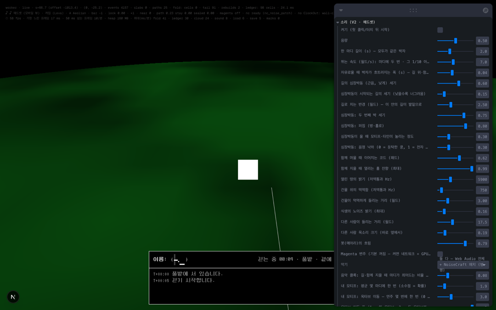
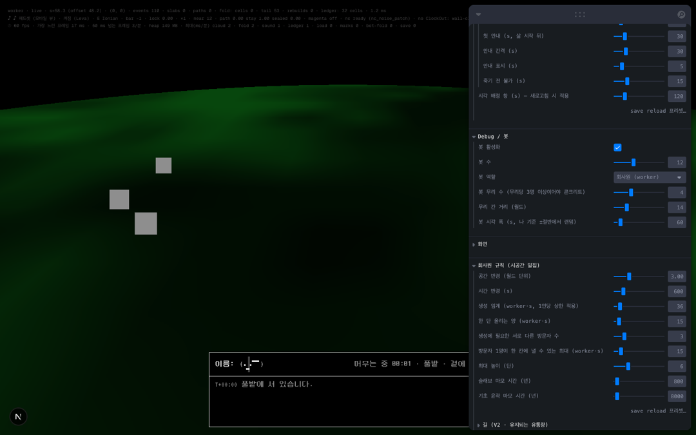
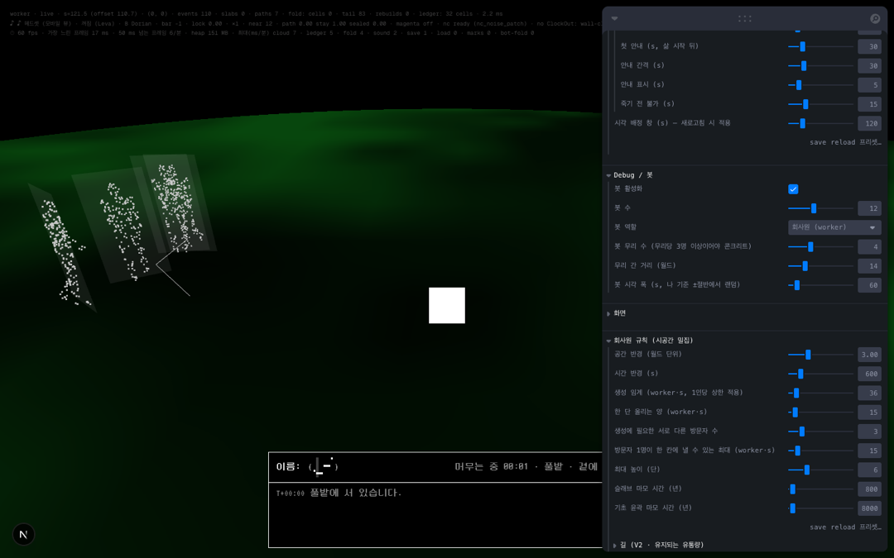
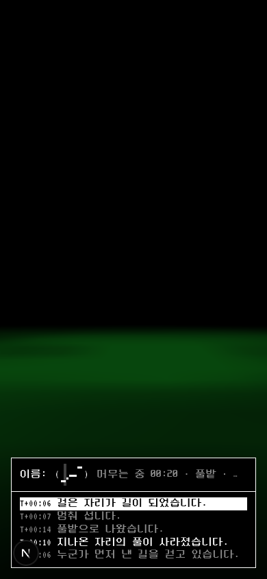

# 개인뷰를 길거리처럼 — 진단 · 안 · 만든 것 (2026-11-22)

작가의 말(2026-11-22): "우리가 집중해야 할 건 … 현실적인 사람 비주얼을 어떤 식으로 구현할 것인가" → "사람의 현실성이라기보단
풍경 같은 거 다 포함해서 **'길거리' 같다는 느낌** 말한 거였음, 걸음걸이도 있겠다만… 좀 더 포괄적인 얘기였어." → "일단 브랜치 파서
해봐야 할 거 같은데."

브랜치 `claude/street-feel-18603e`(재편 `claude/artwork-redesign-continue-385cb8` 33edd36에서), 개발 서버 `web-street` :3028.
레퍼런스는 `docs/reference-study-2026-11-22.md`(브랜치 `claude/personal-impact-logic-d235cf`) §1의 5·12·13·14·15·16·3.

## 0. 한 줄

지금 개인뷰가 길거리로 읽히지 않는 첫째 이유는 **눈의 자리**다 — 카메라가 사람 키가 아니라 **지상 3.9 m, 걷는 이의 6.3 m 뒤**에서
0.45 m짜리 네모를 내려다본다(드론 시점). 둘째는 **사람에게 몸이 없다**(네모 한 칸, 4초에 한 번 칸 가운데로 점프). 셋째는 **깊이가
없다**(브루털 판에는 안개·지평선·하늘이 없어 검은 평면 위의 선 그림). 땅의 결·빛·잔움직임은 그 다음이다.

## 1. 진단

### 1.1 코드에서 확인한 것 (`apps/web/src/components/parliament/`)

| 단서 | 지금 | 어디서 | 길거리와의 거리 |
|---|---|---|---|
| **눈높이** | 카메라 = 걷는 이의 `camDist` 7 뒤, 피치 0.45 → 눈 높이 ≈ 0.45 + 7·sin 0.45 + 0.4 = **3.9 m**, 수평 거리 6.3 m, 시선은 0.65 m 높이의 네모를 향함 | `ParliamentScene.tsx` Controller (`ORB_Y` 0.45, `pitch` 0.45, `camDist` 7) | 사람 눈 1.6 m가 아니라 2층 창에서 내려다보는 시점. 지평선은 화면 위 1/3에 있고 하늘은 없다 |
| **척도** | 1 단위 = 1 m로 설계돼 있다: 봇 걷기 2.2 m/s(`lifecycle.ts` `speed`), 칸 1.2 m(`CELL_SIZE`), 건물 1–6 m(`DEFAULT_FOLD.maxHeight` 6; 개인뷰 페이지엔 생성 규칙이 저장돼 있지 않아 기본값) | `lib/parliament/lifecycle.ts`, `stratum/field.ts`, `types.ts` | 척도 자체는 맞다. 다만 **관객은 7 m/s로 걷는다**(`tgtFwd` 7.0; 사람 1.4 m/s의 5배, 봇의 3배) — 길거리의 속도가 아니라 자전거 속도. 또 건물 외곽선 1–6 m 옆에 사람이 0.8 m 네모라 비례가 안 읽힌다 |
| **사람** | 타인 = `OtherDots square`: 0.8 단위 흰 네모 점 하나, 높이 0.2, **4 s(±25 %)마다 칸 가운데로 하드 컷 점프**, 멜로디 박자로 깜박임, 벽을 뚫고 보임(`depthTest false`) | `Marks.tsx` OtherDots, `usePersonalVisuals.ts` (brutal → `square`, `snap`, `holdSec` 4) | 몸·키·걸음·방향·멈춤이 없다. 10/28의 결정("바쁘게 보이면 안 됨")은 점프로 지켰지만, 그 결과 "사람이 움직인다"가 아니라 "표식이 옮겨진다"로 읽힌다 |
| **표본** | 봇 서버는 0.5 s마다 한 걸음(`relay/bots` `STEP_MS` 500), 뷰는 0.5 s마다 접어(`FOLD_EVERY`) `witness.far`를 갱신 | `RoleField.tsx`, `relay/bots/src/index.ts` | 보간하면 걸음을 만들기에 충분한 밀도. 지금은 보간 없이 4 s 홀드 |
| **땅** | 브루털 기본 = `field`: 밀도만큼 밝은 초록 **평면**(디더 없음), 반경 22의 **하드 원**으로 끝남; 길 = 1 px 흰 선(`PathLines`); 콘크리트 = 외곽선(1 px, 속 비침) | `DitherGround.tsx`, `PathLines.tsx`, `Marks.tsx` ConcreteOutline | 닳음·턱·물자국·균열 같은 무채색 디테일이 없다. 평면 + 선 그림이라 "도면" 느낌. (풀 색은 규칙대로 자연에만) |
| **지평선·하늘·깊이** | 브루털: 안개 없음(`!brutal && <fog>`), 배경 검정, 격자 없음 → 먼 것과 가까운 것이 같은 밝기 | `ParliamentScene.tsx` | 깊이 단서가 원근 축소뿐. 사진 레퍼런스(vinils)는 흰/검 바탕이라도 **번짐·밀도 감소**로 깊이가 있다 |
| **빛** | 앰비언트 0.35 + 방향광 (8, 15, 6) — 그런데 그릴 것이 점·선·`MeshBasic`뿐이라 **빛의 방향이 어디에도 나타나지 않는다**(그림자 없음) | `ParliamentScene.tsx` | 시간대가 없다. 저녁의 긴 그림자(vinils 리가 13)는 지금 구조로는 불가능; 점구름 자체에 그림자 방향을 주는 건 가능 |
| **잔움직임** | 풀의 반응(걷는 자리가 눌림)뿐. 바람·시차 없음. 벽의 `vegFlow`(GPU 흐름)는 벽 전용(`ParliamentSpace`) | `NatureCloud.tsx`, `vegFlow.ts` | 서 있어도 세계가 멈춰 있다 |
| **소리**(적기만) | 헤드셋: 타인의 멜로디·길·건물의 밴드(life-recording 세션 영역) | `lib/sound` | 길거리의 발소리·웅성거림은 없음 — 여기선 다루지 않는다 |

**작가의 값**: 재편 프로덕션의 `/api/presets?page=/v2/mobile`에 저장된 그룹은 `역할 (Role)`(11/01)과 `소리 (V2 · 헤드셋)`(11/22)뿐이다.
즉 **개인뷰의 시각값은 코드 기본값**(브루털 · 면 풀 · 외곽선 콘크리트 · 네모 0.8 · 카메라 7 · dpr 1) — 아래 캡처는 그 값에
프로덕션 봇 서버의 세계다. (`.leva-live/`에는 벽 탭만 있고 개인뷰 탭은 없었다.)

### 1.2 화면에서 본 것

(아래 캡처: 소리 끈 창 없는 Chrome 1440×900, `/v2/mobile?lang=ko`, 프로덕션 봇 서버 세계, 이 브랜치의 기본값 — `docs/img/street-feel/`)

(`before-d1-live-0.png`: 삶 시작 2 s, (0, 0) · `before-d1-walked.png`: 3 s 걷고 멈춘 뒤 (0, −25) · 같은 자리 20 s 뒤의 세 번째 캡처는
스크래치에만. 판 오른쪽의 Leva는 개발 화면이라 보이는 것; 관객 주소에는 없다.)

- **드론 시점**: 지평선이 화면 위 1/4에 있고 그 위는 검정, 아래 3/4가 발밑의 땅이다. 내 자리 = 화면 가운데의 흰 네모(0.8 단위,
  카메라 7 뒤 3.9 위에서 본 것). 사람이 서서 보는 거리의 그림이 아니라 지도의 그림이다.
- **땅은 번진 초록 면**: `field` 풀은 칸 밀도를 `LinearFilter`로 보간한 **흐릿한 초록 얼룩**이고(픽셀도 점도 없음), 반경 22에서 검정으로
  **하드하게 잘린다**(걷는 캡처의 왼쪽 위 — 원의 가장자리). 길은 1 px 흰 선 하나(세 번째 캡처에서 내 뒤로 뻗은 선). 턱·닳음·결 없음.
- **아무도 없다**: 이 자리(무작위 좌석, offset −1013)에서 20 s 동안 `slabs 0`, `near 0 → 3`이었지만 **화면 안에는 타인의 네모가 하나도
  없었다**(near 3은 반경 3 안 = 카메라 뒤·옆일 수 있음). 건물도 없음. 길거리의 첫 조건 — 사람과 건물이 시야 안에 — 이 좌석에 달려
  있다(future-presence의 "봇 곁에 앉힘" c3a7f15가 이 문제를 다룬다; 이 브랜치에는 아직 없음).
- **움직임**: 걷는 3 s 동안 바뀐 것은 땅의 얼룩이 흐르는 것뿐. 흔들리는 것, 스쳐 가는 것, 시차를 주는 기둥이 없다.
- **빛**: 방향광이 있어도 면·선·점뿐이라 그림자도 음영도 없다. 시간대를 알 수 없다.
- **헤드리스 수치**(참고용, GPU 창 아님): 43–58 fps, 가장 느린 프레임 17–33 ms, heap 150–190 MB, `cloud` 최대 24–52 ms/분.

사람이 있을 때의 지금 모습(이 탭의 봇 12명, `?botserver=0` — 공유 세계에는 아무것도 보내지 않음):

- 타인 = **떠 있는 회색 네모 셋**(멜로디가 쉬는 박자라 회색; 치는 박자에 흰색). 땅에서 0.2 떠 있고 크기가 같아 **거리도 키도 읽히지 않는다**.
  4 s마다 칸 가운데로 점프한다. 이것이 "네모 대신"의 네모다.

## 2. 안 셋 (한국어, 각각 느낌 / 바뀌는 것 / 비용 / 규칙)

### 안 A. 눈과 몸 — 눈높이 + 사람 = 걷는 점 실루엣 (**만들었다**, §4)

- **느낌**: 카메라가 사람 키(1.6 m)로 내려오고 걷는 이 1.6 m 뒤에서 수평을 본다. 건물 외곽선이 머리 위로 올라가고, 타인은 네모가 아니라
  **회색 점 480개로 된 걷는 몸**(키 1.7 m)이 되어 걸음·멈춤·몸 돌리기를 한다. 지나간 자리엔 2.5 초의 **시간의 번짐**(vinils 12·13).
- **바뀌는 것**: `PointPeople.tsx`(새 파일, 인스턴스 점 한 드로우 콜), `ParliamentScene.tsx`의 카메라(스위치일 때만 다른 식),
  `usePersonalVisuals.ts`의 Leva 폴더 `개인뷰 비주얼 › 길거리 (시험 · 11/22)`. `RoleField.tsx`는 건드리지 않음(타인 목록은 이미
  `witnessRef.far`로 나와 있음).
- **비용**(M2 8 GB 기준, 코드 읽기): 몸 하나 480점 × (1 + 번짐 복사본 6) = 3,360점. 근처 12명이면 40k 점, 드로우 콜 1 — 풀 점구름
  (최대 90k 점)보다 작다. CPU는 사람마다 매 프레임 덧셈 몇 번. 폰은 200점·번짐 없음. 측정치는 §5.
- **규칙**: 사람 = 무채색(회색 점). 색은 식생에만. 얇은 세운 판(criswvr)은 스위치, 기본 끔.

### 안 B. 깊이 — 브루털 판에 검은 안개 + 지평선

- **느낌**: 먼 것이 어둠으로 가라앉아 **거리가 생긴다**. 사람 실루엣이 멀수록 성겨 보여 "사람 사이의 거리 = 시간"의 그림이 된다.
- **바뀌는 것**: `ParliamentScene.tsx` 한 줄 — 브루털에서도 `<fog>`(검정, `화면 › fogNear/fogFar`). 콘크리트 외곽선과 네모는
  `fog={false}`라 그대로이고, 풀 면·점 실루엣(스위치)·길 선만 받는다. **만들었다**(길거리 폴더의 `깊이 안개`). 지평선/하늘은
  미구현 — 브루털의 검은 바탕을 유지하면 "밤의 길거리"로 읽히고, 하늘을 넣으면 룩이 바뀌므로 작가 결정.
- **비용**: 0 (셰이더 안개).
- **규칙**: 무채색. 작가의 11/01 "브루털 = 안개 없음" 결정과 충돌 — 그래서 스위치.

### 안 C. 땅과 주변의 생기 — 무채색 닳음 + 서 있는 무리 + 바람 (미구현, 작가가 고르면 단계로)

- **느낌**: 발밑이 평면이 아니라 **길이 난 곳은 닳아 밝고 가장자리는 턱이 진** 땅; 길 가에 **서 있는 둘셋**(지금 봇 서버의 `hMeetStay`
  머무름이 이미 있음 — 몸이 생기면 그대로 읽힘); 풀 점이 바람에 **흔들린다**.
- **바뀌는 것**: `StreetGround.tsx`(새 파일): `DitherGround`의 밀도 텍스처에 **길 강도(`snap.paths`)의 회색 닳음 레이어**와 칸 경계의
  1 px 턱(이미 `PathLines`가 선을 긋는다 — 이것을 "닳은 면"으로 넓히는 것); `NatureCloud`의 점에 사인 바람 1줄(정점 셰이더, `vegFlow`
  의 흐름이 아니라 흔들림만).
- **비용**: 닳음 레이어 = 텍스처 한 장 더(0.1 s 갱신, 이미 하는 일과 같은 비용); 바람 = 셰이더 1줄, 0.
- **규칙**: 길·턱·닳음은 사람의 흔적 → 회색. 풀의 흔들림은 색을 바꾸지 않음.

### 고르지 않은 것 (적어 둠)

- **빛의 방향과 긴 그림자**: 점·선 세계에는 그림자가 없다. 점 실루엣에 "그림자 복사본"(같은 몸을 바닥에 눕혀 길게 늘인 어두운 점)을
  한 벌 더 찍으면 저녁 빛이 생기지만, 콘크리트 외곽선은 그림자를 못 드리운다 → 반쪽. 작가가 원하면 사람에게만.
- **걷는 속도 7 → 2.5 m/s**: 가장 싼 "길거리"일 수 있으나 삶 180 s 동안 갈 수 있는 거리가 1/3이 된다(세계 160칸 = 192 m). 작가 결정.

## 3. 사람 = 점 실루엣 — 구현 (P1 + P4)

- **P1 걷기 사이클**: `lib/parliament/pointPeople.ts` `bakeWalk` — 절차적 골격(사인 고관절 ±0.42 rad, 스윙 때만 접히는 무릎, 반대로
  흔드는 팔, 두 걸음에 한 번 2.2 cm 위아래)을 **16 프레임 × 480점**으로 구워 float 텍스처(한 줄 = 한 프레임)에 둔다. 점 i는 모든
  프레임에서 같은 부위의 같은 자리 → GPU가 이웃 두 프레임을 섞는다. 부위 배분은 황금비 수열이라 **앞 200점만 써도 몸 전체**(폰).
  모션캡처 파일은 쓰지 않았다(CMU 등을 받고 싶으면 파일·출처·크기를 적어 작가에게 먼저 묻는다; `jointsAt`만 바꾸면 된다).
- **움직임의 질**: 봇 서버 표본(0.5 s)을 그대로 쓰지 않고 `stepPerson` — 표본을 향해 가속(5/s)·최고 2.6 m/s·0.45 s 안에 도착하는
  완화, 속도로 보폭(1.35 m/사이클)의 위상 진행, 5 rad/s로 가는 방향을 향해 몸 돌리기, 0.18 m/s 아래면 **서서** 다리를 모으고 **숨**
  (가슴 1.2 % 위아래, 저마다의 박자). 8 m 넘는 점프는 컷(세계의 감김, 새 삶).
- **P4 시간의 번짐**: 사람마다 최근 `smearSec`(2.5 s) 동안의 자리 링버퍼(복사본 6) — 같은 몸을 뒤로 복사해 알파를 (1−나이)²로 줄인다.
  서 있을 땐 남기지 않는다. 폰은 끔.
- **그리기**: `InstancedBufferGeometry` + `THREE.Points`, 인스턴스 속성 `iPos`(x, y, z, 방향) `iAnim`(위상, 알파, 서 있음, 해시).
  **드로우 콜 1**(몸 + 복사본 모두). 네모 점(브루털), 회색 0.78, `depthWrite false`. 세운 판은 `InstancedMesh` 하나(스위치).
- **입력**: `witnessRef.current.far`(RoleField가 접을 때마다 갱신, 반경 24) — 기존 표식과 같은 목록. 켜면 `OtherDots`의 네모는 꺼진다
  (`marks.others.on = othersOn && !(streetOn && streetPeople)`).

## 4. 만든 것 — Leva `개인뷰 비주얼 › 길거리 (시험 · 11/22)` (기본값 = 지금 룩)

| 노브 | 기본 | 뜻 |
|---|---|---|
| 켜기 | 끔 | 끄면 아래 모두 꺼짐 — 지금 룩 그대로 |
| 사람 = 걷는 점 실루엣 | 켬 | `PointPeople` (네모 대신) |
| 몸 하나의 점 수 / 폰 | 480 / 200 | |
| 점 크기 · 회색 밝기 · 키 | 0.045 · 0.78 · 1.7 | |
| 표본 사이 최고 속도 | 2.6 | 보간의 상한 (봇 2.2) |
| 서 있을 때 숨 | 1 | 0 = 없음 |
| 시간의 번짐 — 몇 초 / 복사본 | 2.5 s / 6 | 0 = 없음; 폰은 늘 없음 |
| 세운 판 / 불투명도 | 끔 / 0.08 | criswvr |
| 점이 안개를 받음 | 끔 | |
| 눈높이 / 높이 / 뒤로 / 시선 거리 | 끔 / 1.6 / 1.6 / 6 | 카메라를 사람 키에, 걷는 이 바로 뒤, 수평 시선(마우스·드래그로 기울임) |
| 깊이 안개 | 끔 | 브루털에도 검은 안개 (`화면 › fogNear/fogFar`) |

### 켰을 때 (캡처, 같은 헤드리스 Chrome)

`사람 = 걷는 점 실루엣` + `세운 판`만 켬(카메라 7 뒤 그대로, 이 탭의 봇 12명): 네모 셋이 섰던 자리에 **회색 점 몸 셋**이 판 안에 선다.
드론 시점이라 아직 작게 보이지만 키와 거리가 생겼다.

관객 주소(`/v2/mobile?ui=0`, 폰 390×844, **프로덕션 봇 서버의 세계**, 무작위 좌석에 건물 11칸): `눈높이` + `깊이 안개` + `사람`.
건물 외곽선이 눈높이에서 벽처럼 서고, 길 선이 원근으로 바닥에 깔리고, 그 옆에 **점 실루엣 한 사람이 제 키(외곽선의 비례)로 서 있다**.
땅의 면은 먼 쪽에서 안개로 가라앉는다(원반의 가장자리가 아니라 지평선). 이것이 "길거리"의 첫 장면이다 — 사람이 걷는 건 영상으로 봐야 한다.

같은 삶 20 s 뒤(15 m 걸어 나온 자리): 앞에 아무것도 없으면 어두운 풀과 안개뿐이다 — 좌석이 길거리를 정한다(§1.2 "아무도 없다").

데스크톱 눈높이(봇 12명이 있었지만 이 순간 시야 87° 밖): 지평선이 화면 가운데로 내려오고 위 절반이 하늘(검정)이 된다.
`window.__street`(콘솔)에 그리는 몸·복사본 수와 가장 가까운 몸이 나온다.

파일: `apps/web/src/lib/parliament/pointPeople.ts`(순수: 베이크·보간), `apps/web/src/components/parliament/PointPeople.tsx`,
`usePersonalVisuals.ts`(폴더·`street`), `ParliamentScene.tsx`(카메라 분기, 안개 조건, `<PointPeople>` 마운트). `RoleField.tsx`·
`rise.ts`·`useBotServer.ts`·`relay/bots`·`SessionHud.tsx`·`lib/sound`는 건드리지 않았다.

## 5. 측정

GPU 창이 아니라 **헤드리스 Chrome**(이 M2 8 GB, 다른 개발 서버 넷이 도는 중)의 ⏱ 줄이다 — 절대값이 아니라 전/후의 차이만 읽는다.
Claude pane은 이 세션 창이 열려 있지 않아 0×0(3D가 안 뜸)이라 쓸 수 없었다. 작가의 창에서의 실측은 프리뷰에서.

| 조건 (1440×900, dpr 1) | fps | 가장 느린 프레임 | heap |
|---|---|---|---|
| 지금 룩, 아무도 없음 (프로덕션 세계, d1) | 43–58 | 17–33 ms | 150–190 MB |
| 지금 룩, 봇 12명 네모 (d4) | 60 | 17 ms | 149 MB |
| 사람 점 실루엣 3명 보임 + 판 (d5) | 60 | 17 ms | 151–168 MB |
| 눈높이 + 안개 + 사람 (d3, 15 s) | 54–60 | 17–33 ms | 138–145 MB |

- 코드 쪽 비용: 몸 하나 480점, 복사본 6 → 3,360점; 12명 = 40k 점, **드로우 콜 1**(판은 +1). 풀 점구름(최대 90k, `cloud` 24–59 ms/분)보다 작다.
  CPU: 사람마다 프레임당 보간 몇 줄 + 인스턴스 배열 쓰기(12명 × 7 × 8 float). 베이크는 처음 한 번 19 ms(Node 실측).
- 폰: 200점·번짐 없음 → 12명 = 2,400점.

## 6. 작가 결정 기록

- (대기) 안 A·B·C 중 무엇을, 어느 순서로.
- (대기) 사람 점은 회색만인가(레퍼런스 3·5는 색이 있지만 규칙은 사람 = 무채색).
- (대기) 걷는 속도 7 → 2.5 m/s로 내릴 것인가.
- (대기) 브루털에 안개(깊이)를 허용할 것인가 — 11/01의 "안개 없음"과 충돌.
