# 개인뷰를 길거리처럼 — 진단 · 안 · 만든 것 (2026-11-22)

작가의 말(2026-11-22): "우리가 집중해야 할 건 … 현실적인 사람 비주얼을 어떤 식으로 구현할 것인가" → "사람의 현실성이라기보단
풍경 같은 거 다 포함해서 **'길거리' 같다는 느낌** 말한 거였음, 걸음걸이도 있겠다만… 좀 더 포괄적인 얘기였어." → "일단 브랜치 파서
해봐야 할 거 같은데."

브랜치 `claude/street-feel-18603e`(재편 `claude/artwork-redesign-continue-385cb8` 33edd36에서; 11/22 저녁 재편 head e4f7d46 —
future-presence의 봇 옆 출생·발굴자 마주침, me-marker, 대화 소리 — 를 합쳐 둠), 개발 서버 `web-street` :3028.
**작가가 보는 곳**: **`https://anthropocene-street-feel.vercel.app`**(짧은 별칭; 푸시마다 최신 배포에 다시 붙임) = Vercel 브랜치 프리뷰
`https://anthropocene-redesign-git-claude-st-50db43-hesse-parks-projects.vercel.app`(자동) —
`/v2/mobile?lang=ko`에서 Leva `개인뷰 비주얼 › 길거리 (시험 · 11/22) › 켜기`를 켜고 본다(기본은 지금 룩; `/exhibition/personal`은 Leva가
없으니 거기선 바뀐 것이 없다). 폰도 같은 주소.
레퍼런스는 `docs/reference-study-2026-11-22.md`(브랜치 `claude/personal-impact-logic-d235cf`) §1의 5·12·13·14·15·16·3.

## 0. 한 줄

지금 개인뷰가 길거리로 읽히지 않는 첫째 이유는 **눈의 자리**다 — 카메라가 사람 키가 아니라 **지상 3.9 m, 걷는 이의 6.3 m 뒤**에서
0.45 m짜리 네모를 내려다본다(드론 시점). 둘째는 **사람에게 몸이 없다**(네모 한 칸, 4초에 한 번 칸 가운데로 점프). 셋째는 **깊이가
없다**(브루털 판에는 안개·지평선·하늘이 없어 검은 평면 위의 선 그림). 땅의 결·빛·잔움직임은 그 다음이다.

## 1. 진단

### 1.1 코드에서 확인한 것 (`apps/web/src/components/parliament/`)

| 단서 | 지금 | 어디서 | 길거리와의 거리 |
|---|---|---|---|
| **눈높이** | 카메라 = 걷는 이의 `camDist` 7 뒤, 피치 0.45 → 눈 높이 ≈ 0.45 + 7·sin 0.45 + 0.4 = **3.9 m**, 수평 거리 6.3 m, 시선은 0.65 m 높이의 네모를 향함 | `ParliamentScene.tsx` Controller (`ORB_Y` 0.45, `pitch` 0.45, `camDist` 7) | 사람 눈 1.6 m가 아니라 2층 창에서 내려다보는 시점. 지평선은 화면 위 1/3에 있고 하늘은 없다 |
| **척도** | 1 단위 = 1 m로 설계돼 있다: 봇 걷기 2.2 m/s(`lifecycle.ts` `speed`), 칸 1.2 m(`CELL_SIZE`), 건물 1–6 m(`DEFAULT_FOLD.maxHeight` 6; 개인뷰 페이지엔 생성 규칙이 저장돼 있지 않아 기본값) | `lib/parliament/lifecycle.ts`, `stratum/field.ts`, `types.ts` | 척도 자체는 맞다. 다만 **관객은 7 m/s로 걷는다**(`tgtFwd` 7.0; 사람 1.4 m/s의 5배, 봇의 3배) — 길거리의 속도가 아니라 자전거 속도. 또 건물 외곽선 1–6 m 옆에 사람이 0.8 m 네모라 비례가 안 읽힌다 |
| **사람** | 타인 = `OtherDots square`: 0.8 단위 흰 네모 점 하나, 높이 0.2, **4 s(±25 %)마다 칸 가운데로 하드 컷 점프**, 멜로디 박자로 깜박임, 벽을 뚫고 보임(`depthTest false`) | `Marks.tsx` OtherDots, `usePersonalVisuals.ts` (brutal → `square`, `snap`, `holdSec` 4) | 몸·키·걸음·방향·멈춤이 없다. 10/28의 결정("바쁘게 보이면 안 됨")은 점프로 지켰지만, 그 결과 "사람이 움직인다"가 아니라 "표식이 옮겨진다"로 읽힌다 |
| **표본** | 봇 서버는 0.5 s마다 한 걸음(`relay/bots` `STEP_MS` 500), 뷰는 0.5 s마다 접어(`FOLD_EVERY`) `witness.far`를 갱신 | `RoleField.tsx`, `relay/bots/src/index.ts` | 보간하면 걸음을 만들기에 충분한 밀도. 지금은 보간 없이 4 s 홀드 |
| **땅** | 브루털 기본 = `field`: 밀도만큼 밝은 초록 **평면**(디더 없음), 반경 22의 **하드 원**으로 끝남; 길 = 1 px 흰 선(`PathLines`); 콘크리트 = 외곽선(1 px, 속 비침) | `DitherGround.tsx`, `PathLines.tsx`, `Marks.tsx` ConcreteOutline | 닳음·턱·물자국·균열 같은 무채색 디테일이 없다. 평면 + 선 그림이라 "도면" 느낌. (풀 색은 규칙대로 자연에만) |
| **지평선·하늘·깊이** | 브루털: 안개 없음(`!brutal && <fog>`), 배경 검정, 격자 없음 → 먼 것과 가까운 것이 같은 밝기 | `ParliamentScene.tsx` | 깊이 단서가 원근 축소뿐. 사진 레퍼런스(vinils)는 흰/검 바탕이라도 **번짐·밀도 감소**로 깊이가 있다 |
| **빛** | 앰비언트 0.35 + 방향광 (8, 15, 6) — 그런데 그릴 것이 점·선·`MeshBasic`뿐이라 **빛의 방향이 어디에도 나타나지 않는다**(그림자 없음) | `ParliamentScene.tsx` | 시간대가 없다. 저녁의 긴 그림자(vinils 리가 13)는 지금 구조로는 불가능; 점구름 자체에 그림자 방향을 주는 건 가능 |
| **잔움직임** | 풀의 반응(걷는 자리가 눌림)뿐. 바람·시차 없음. 벽의 `vegFlow`(GPU 흐름)는 벽 전용(`ParliamentSpace`) | `NatureCloud.tsx`, `vegFlow.ts` | 서 있어도 세계가 멈춰 있다 |
| **소리**(적기만) | 헤드셋: 타인의 멜로디·길·건물의 밴드(life-recording 세션 영역) | `lib/sound` | 길거리의 발소리·웅성거림은 없음 — 여기선 다루지 않는다 |

**작가의 값**: 재편 프로덕션의 `/api/presets?page=/v2/mobile`에 저장된 그룹은 `역할 (Role)`(11/01)과 `소리 (V2 · 헤드셋)`(11/22)뿐이다.
즉 **개인뷰의 시각값은 코드 기본값**(브루털 · 면 풀 · 외곽선 콘크리트 · 네모 0.8 · 카메라 7 · dpr 1) — 아래 캡처는 그 값에
프로덕션 봇 서버의 세계다. (`.leva-live/`에는 벽 탭만 있고 개인뷰 탭은 없었다.)

### 1.2 화면에서 본 것

(아래 캡처: 소리 끈 창 없는 Chrome 1440×900, `/v2/mobile?lang=ko`, 프로덕션 봇 서버 세계, 이 브랜치의 기본값 — `docs/img/street-feel/`)

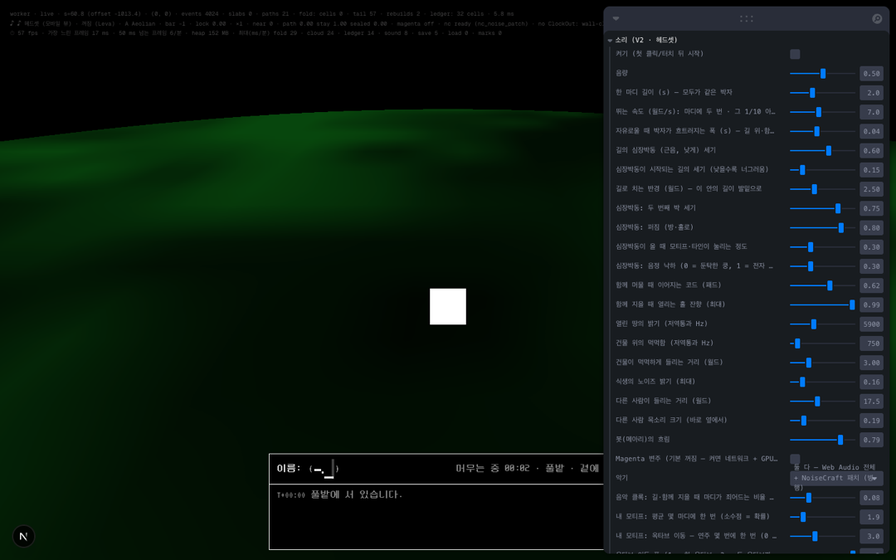

(`before-d1-live-0.png`: 삶 시작 2 s, (0, 0) · `before-d1-walked.png`: 3 s 걷고 멈춘 뒤 (0, −25) · 같은 자리 20 s 뒤의 세 번째 캡처는
스크래치에만. 판 오른쪽의 Leva는 개발 화면이라 보이는 것; 관객 주소에는 없다.)

- **드론 시점**: 지평선이 화면 위 1/4에 있고 그 위는 검정, 아래 3/4가 발밑의 땅이다. 내 자리 = 화면 가운데의 흰 네모(0.8 단위,
  카메라 7 뒤 3.9 위에서 본 것). 사람이 서서 보는 거리의 그림이 아니라 지도의 그림이다.
- **땅은 번진 초록 면**: `field` 풀은 칸 밀도를 `LinearFilter`로 보간한 **흐릿한 초록 얼룩**이고(픽셀도 점도 없음), 반경 22에서 검정으로
  **하드하게 잘린다**(걷는 캡처의 왼쪽 위 — 원의 가장자리). 길은 1 px 흰 선 하나(세 번째 캡처에서 내 뒤로 뻗은 선). 턱·닳음·결 없음.
- **아무도 없다**: 이 자리(무작위 좌석, offset −1013)에서 20 s 동안 `slabs 0`, `near 0 → 3`이었지만 **화면 안에는 타인의 네모가 하나도
  없었다**(near 3은 반경 3 안 = 카메라 뒤·옆일 수 있음). 건물도 없음. 길거리의 첫 조건 — 사람과 건물이 시야 안에 — 이 좌석에 달려
  있다(future-presence의 "봇 곁에 앉힘" c3a7f15가 이 문제를 다룬다; 이 브랜치에는 아직 없음).
- **움직임**: 걷는 3 s 동안 바뀐 것은 땅의 얼룩이 흐르는 것뿐. 흔들리는 것, 스쳐 가는 것, 시차를 주는 기둥이 없다.
- **빛**: 방향광이 있어도 면·선·점뿐이라 그림자도 음영도 없다. 시간대를 알 수 없다.
- **헤드리스 수치**(참고용, GPU 창 아님): 43–58 fps, 가장 느린 프레임 17–33 ms, heap 150–190 MB, `cloud` 최대 24–52 ms/분.

사람이 있을 때의 지금 모습(이 탭의 봇 12명, `?botserver=0` — 공유 세계에는 아무것도 보내지 않음):

- 타인 = **떠 있는 회색 네모 셋**(멜로디가 쉬는 박자라 회색; 치는 박자에 흰색). 땅에서 0.2 떠 있고 크기가 같아 **거리도 키도 읽히지 않는다**.
  4 s마다 칸 가운데로 점프한다. 이것이 "네모 대신"의 네모다.

## 2. 안 셋 (한국어, 각각 느낌 / 바뀌는 것 / 비용 / 규칙)

### 안 A. 눈과 몸 — 눈높이 + 사람 = 걷는 점 실루엣 (**만들었다**, §4)

- **느낌**: 카메라가 사람 키(1.6 m)로 내려오고 걷는 이 1.6 m 뒤에서 수평을 본다. 건물 외곽선이 머리 위로 올라가고, 타인은 네모가 아니라
  **회색 점 480개로 된 걷는 몸**(키 1.7 m)이 되어 걸음·멈춤·몸 돌리기를 한다. 지나간 자리엔 2.5 초의 **시간의 번짐**(vinils 12·13).
- **바뀌는 것**: `PointPeople.tsx`(새 파일, 인스턴스 점 한 드로우 콜), `ParliamentScene.tsx`의 카메라(스위치일 때만 다른 식),
  `usePersonalVisuals.ts`의 Leva 폴더 `개인뷰 비주얼 › 길거리 (시험 · 11/22)`. `RoleField.tsx`는 건드리지 않음(타인 목록은 이미
  `witnessRef.far`로 나와 있음).
- **비용**(M2 8 GB 기준, 코드 읽기): 몸 하나 480점 × (1 + 번짐 복사본 6) = 3,360점. 근처 12명이면 40k 점, 드로우 콜 1 — 풀 점구름
  (최대 90k 점)보다 작다. CPU는 사람마다 매 프레임 덧셈 몇 번. 폰은 200점·번짐 없음. 측정치는 §5.
- **규칙**: 사람 = 무채색(회색 점). 색은 식생에만. 얇은 세운 판(criswvr)은 스위치, 기본 끔.

### 안 B. 깊이 — 브루털 판에 검은 안개 + 지평선

- **느낌**: 먼 것이 어둠으로 가라앉아 **거리가 생긴다**. 사람 실루엣이 멀수록 성겨 보여 "사람 사이의 거리 = 시간"의 그림이 된다.
- **바뀌는 것**: `ParliamentScene.tsx` 한 줄 — 브루털에서도 `<fog>`(검정, `화면 › fogNear/fogFar`). 콘크리트 외곽선과 네모는
  `fog={false}`라 그대로이고, 풀 면·점 실루엣(스위치)·길 선만 받는다. **만들었다**(길거리 폴더의 `깊이 안개`). 지평선/하늘은
  미구현 — 브루털의 검은 바탕을 유지하면 "밤의 길거리"로 읽히고, 하늘을 넣으면 룩이 바뀌므로 작가 결정.
- **비용**: 0 (셰이더 안개).
- **규칙**: 무채색. 작가의 11/01 "브루털 = 안개 없음" 결정과 충돌 — 그래서 스위치.

### 안 C. 땅과 주변의 생기 — 무채색 닳음 + 서 있는 무리 + 바람 (미구현, 작가가 고르면 단계로)

- **느낌**: 발밑이 평면이 아니라 **길이 난 곳은 닳아 밝고 가장자리는 턱이 진** 땅; 길 가에 **서 있는 둘셋**(지금 봇 서버의 `hMeetStay`
  머무름이 이미 있음 — 몸이 생기면 그대로 읽힘); 풀 점이 바람에 **흔들린다**.
- **바뀌는 것**: `StreetGround.tsx`(새 파일): `DitherGround`의 밀도 텍스처에 **길 강도(`snap.paths`)의 회색 닳음 레이어**와 칸 경계의
  1 px 턱(이미 `PathLines`가 선을 긋는다 — 이것을 "닳은 면"으로 넓히는 것); `NatureCloud`의 점에 사인 바람 1줄(정점 셰이더, `vegFlow`
  의 흐름이 아니라 흔들림만).
- **비용**: 닳음 레이어 = 텍스처 한 장 더(0.1 s 갱신, 이미 하는 일과 같은 비용); 바람 = 셰이더 1줄, 0.
- **규칙**: 길·턱·닳음은 사람의 흔적 → 회색. 풀의 흔들림은 색을 바꾸지 않음.

### 고르지 않은 것 (적어 둠)

- **빛의 방향과 긴 그림자**: 점·선 세계에는 그림자가 없다. 점 실루엣에 "그림자 복사본"(같은 몸을 바닥에 눕혀 길게 늘인 어두운 점)을
  한 벌 더 찍으면 저녁 빛이 생기지만, 콘크리트 외곽선은 그림자를 못 드리운다 → 반쪽. 작가가 원하면 사람에게만.
- **걷는 속도 7 → 2.5 m/s**: 가장 싼 "길거리"일 수 있으나 삶 180 s 동안 갈 수 있는 거리가 1/3이 된다(세계 160칸 = 192 m). 작가 결정.

## 3. 사람 = 점 실루엣 — 구현 (P1 + P4)

- **P1 걷기 사이클**: `lib/parliament/pointPeople.ts` `bakeWalk` — 절차적 골격(사인 고관절 ±0.42 rad, 스윙 때만 접히는 무릎, 반대로
  흔드는 팔, 두 걸음에 한 번 2.2 cm 위아래)을 **16 프레임 × 480점**으로 구워 float 텍스처(한 줄 = 한 프레임)에 둔다. 점 i는 모든
  프레임에서 같은 부위의 같은 자리 → GPU가 이웃 두 프레임을 섞는다. 부위 배분은 황금비 수열이라 **앞 200점만 써도 몸 전체**(폰).
  모션캡처 파일은 쓰지 않았다(CMU 등을 받고 싶으면 파일·출처·크기를 적어 작가에게 먼저 묻는다; `jointsAt`만 바꾸면 된다).
- **움직임의 질**: 봇 서버 표본(0.5 s)을 그대로 쓰지 않고 `stepPerson` — 표본을 향해 가속(5/s)·최고 2.6 m/s·0.45 s 안에 도착하는
  완화, 속도로 보폭(1.35 m/사이클)의 위상 진행, 5 rad/s로 가는 방향을 향해 몸 돌리기, 0.18 m/s 아래면 **서서** 다리를 모으고 **숨**
  (가슴 1.2 % 위아래, 저마다의 박자). 8 m 넘는 점프는 컷(세계의 감김, 새 삶).
- **P4 시간의 번짐**: 사람마다 최근 `smearSec`(2.5 s) 동안의 자리 링버퍼(복사본 6) — 같은 몸을 뒤로 복사해 알파를 (1−나이)²로 줄인다.
  서 있을 땐 남기지 않는다. 폰은 끔.
- **그리기**: `InstancedBufferGeometry` + `THREE.Points`, 인스턴스 속성 `iPos`(x, y, z, 방향) `iAnim`(위상, 알파, 서 있음, 해시).
  **드로우 콜 1**(몸 + 복사본 모두). 네모 점(브루털), 회색 0.78, `depthWrite false`. 세운 판은 `InstancedMesh` 하나(스위치).
- **입력**: `witnessRef.current.far`(RoleField가 접을 때마다 갱신, 반경 24) — 기존 표식과 같은 목록. 켜면 `OtherDots`의 네모는 꺼진다
  (`marks.others.on = othersOn && !(streetOn && streetPeople)`).

## 4. 만든 것 — Leva `개인뷰 비주얼 › 길거리 (시험 · 11/22)` (기본값 = 지금 룩)

| 노브 | 기본 | 뜻 |
|---|---|---|
| 켜기 | 끔 | 끄면 아래 모두 꺼짐 — 지금 룩 그대로 |
| 사람 = 걷는 점 실루엣 | 켬 | `PointPeople` (네모 대신) |
| 몸 하나의 점 수 / 폰 | 480 / 200 | |
| 점 크기 · 회색 밝기 · 키 | 0.045 · 0.78 · 1.7 | |
| 표본 사이 최고 속도 | 2.6 | 보간의 상한 (봇 2.2) |
| 서 있을 때 숨 | 1 | 0 = 없음 |
| 시간의 번짐 — 몇 초 / 복사본 | 2.5 s / 6 | 0 = 없음; 폰은 늘 없음 |
| 세운 판 / 불투명도 | 끔 / 0.08 | criswvr |
| 점이 안개를 받음 | 끔 | |
| 눈높이 / 높이 / 뒤로 / 시선 거리 | 끔 / 1.6 / 1.6 / 6 | 카메라를 사람 키에, 걷는 이 바로 뒤, 수평 시선(마우스·드래그로 기울임) |
| 깊이 안개 | 끔 | 브루털에도 검은 안개 (`화면 › fogNear/fogFar`) |

### 켰을 때 (캡처, 같은 헤드리스 Chrome)

`사람 = 걷는 점 실루엣` + `세운 판`만 켬(카메라 7 뒤 그대로, 이 탭의 봇 12명): 네모 셋이 섰던 자리에 **회색 점 몸 셋**이 판 안에 선다.
드론 시점이라 아직 작게 보이지만 키와 거리가 생겼다.

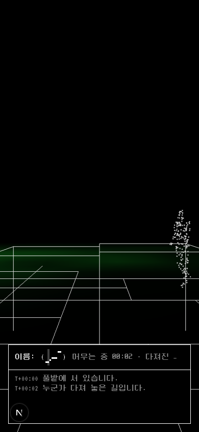

관객 주소(`/v2/mobile?ui=0`, 폰 390×844, **프로덕션 봇 서버의 세계**, 무작위 좌석에 건물 11칸): `눈높이` + `깊이 안개` + `사람`.
건물 외곽선이 눈높이에서 벽처럼 서고, 길 선이 원근으로 바닥에 깔리고, 그 옆에 **점 실루엣 한 사람이 제 키(외곽선의 비례)로 서 있다**.
땅의 면은 먼 쪽에서 안개로 가라앉는다(원반의 가장자리가 아니라 지평선). 이것이 "길거리"의 첫 장면이다 — 사람이 걷는 건 영상으로 봐야 한다.

같은 삶 20 s 뒤(15 m 걸어 나온 자리): 앞에 아무것도 없으면 어두운 풀과 안개뿐이다 — 좌석이 길거리를 정한다(§1.2 "아무도 없다").

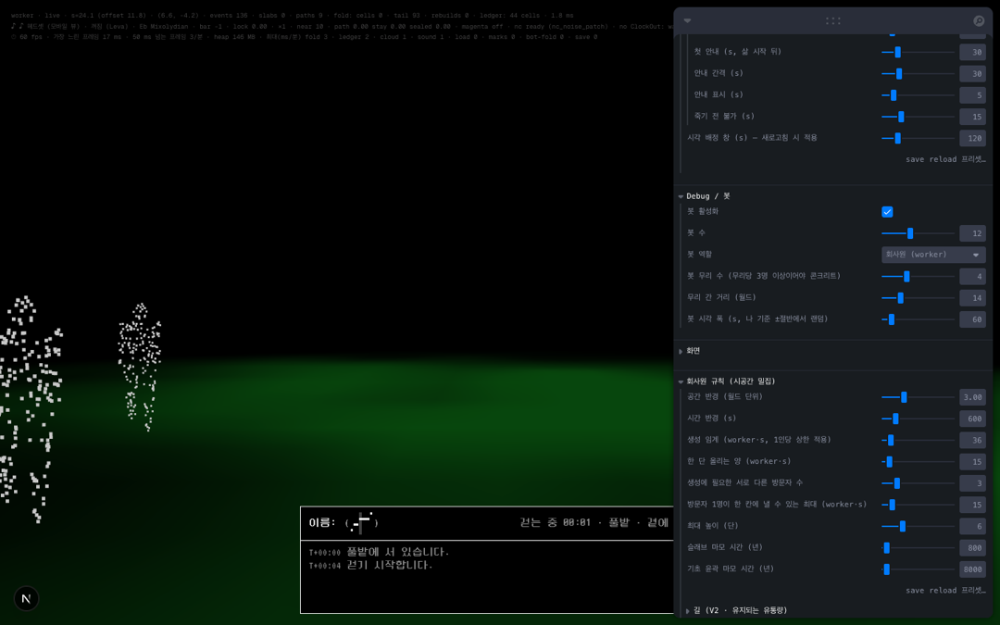

데스크톱 눈높이, 45° 돌아본 뒤(이 탭의 봇 12명; `window.__street` = people 12 · instances 12 · nearest 5.5 m): 지평선이 화면
가운데로 내려오고 위 절반이 하늘(검정), **5–6 m 앞에 선 두 사람이 제 키로** 보인다. 헤드리스의 터치 에뮬레이션 탓에 폰 경로(200점,
번짐 없음)로 그려졌다 — 데스크톱에서는 480점 + 번짐.

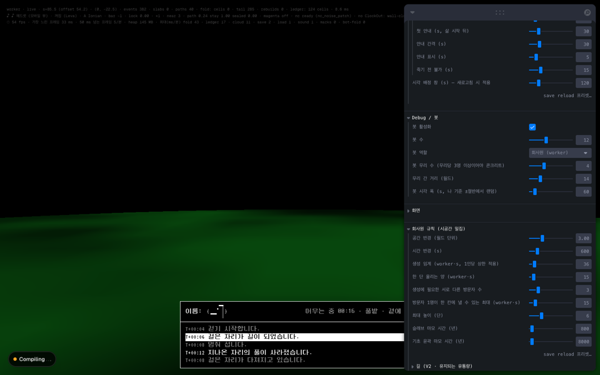

같은 조건에서 사람이 시야 87° 밖일 때: 어두운 풀과 지평선뿐. (`window.__street`(콘솔)에 그리는 몸·복사본 수와 가장 가까운 몸이 나온다.)

파일: `apps/web/src/lib/parliament/pointPeople.ts`(순수: 베이크·보간), `apps/web/src/components/parliament/PointPeople.tsx`,
`usePersonalVisuals.ts`(폴더·`street`), `ParliamentScene.tsx`(카메라 분기, 안개 조건, `<PointPeople>` 마운트). `RoleField.tsx`·
`rise.ts`·`useBotServer.ts`·`relay/bots`·`SessionHud.tsx`·`lib/sound`는 건드리지 않았다.

## 5. 측정

GPU 창이 아니라 **헤드리스 Chrome**(이 M2 8 GB, 다른 개발 서버 넷이 도는 중)의 ⏱ 줄이다 — 절대값이 아니라 전/후의 차이만 읽는다.
Claude pane은 이 세션 창이 열려 있지 않아 0×0(3D가 안 뜸)이라 쓸 수 없었다. 작가의 창에서의 실측은 프리뷰에서.

| 조건 (1440×900, dpr 1) | fps | 가장 느린 프레임 | heap |
|---|---|---|---|
| 지금 룩, 아무도 없음 (프로덕션 세계, d1) | 43–58 | 17–33 ms | 150–190 MB |
| 지금 룩, 봇 12명 네모 (d4) | 60 | 17 ms | 149 MB |
| 사람 점 실루엣 3명 보임 + 판 (d5) | 60 | 17 ms | 151–168 MB |
| 눈높이 + 안개 + 사람 (d3, 15 s) | 54–60 | 17–33 ms | 138–145 MB |

- 코드 쪽 비용: 몸 하나 480점, 복사본 6 → 3,360점; 12명 = 40k 점, **드로우 콜 1**(판은 +1). 풀 점구름(최대 90k, `cloud` 24–59 ms/분)보다 작다.
  CPU: 사람마다 프레임당 보간 몇 줄 + 인스턴스 배열 쓰기(12명 × 7 × 8 float). 베이크는 처음 한 번 19 ms(Node 실측).
- 폰: 200점·번짐 없음 → 12명 = 2,400점.

## 6. 작가 결정 기록

- **2026-11-22 저녁: "둘 다 해보자"** — A(눈높이·사람 다듬기)와 C(땅과 생기)를 둘 다, 단계로. → §7.
- **2026-11-22 밤 (프리뷰를 본 뒤)**: "기본값 내리고(걷는 속도), 지금 봇이 건물 폭에 비해 너무 크고, 사람 실루엣은 구체적인데 걸음이
  완전히 자연스럽진 않으니 어색한 것도 있음. 사람 사이즈나 움직임도 다양해야 할 것 같고… 나무랑 배율이 좀 맞아야 할 거 아냐. 그리고
  이렇게 되면 '나'를 굳이 시선 앞에 사각형으로 둬야 하나 싶기도 하고. 근데 그러면 또 리듬은 어떻게 전달하고?" → §8.
- **2026-11-22 밤 (이어서)**: "그냥 1인칭으로 해버리고, 누군가 말 걸 때 말거는 애한테 큐 주고, 나도 뭔가 다른 방식으로 느낄 수 있도록" →
  곧바로 "**오 아니면 깜빡이는 상자 속에서 사람 실루엣이 걸어가는 것처럼 보이도록 하면 되겠다!! 이러면 점 낭비 안 해도 되고** — 타인 말이야.
  이러면 나도 그냥 상자로 고정해도 되고" → §10.
- (대기) 사람 점은 회색만인가(레퍼런스 3·5는 색이 있지만 규칙은 사람 = 무채색).
- (대기) 걷는 속도 7 → 2.5 m/s로 내릴 것인가.
- (대기) 브루털에 안개(깊이)를 허용할 것인가 — 11/01의 "안개 없음"과 충돌.

## 7. 단계 기록 ("둘 다 해보자" 뒤)

같은 Leva 폴더 `개인뷰 비주얼 › 길거리 (시험 · 11/22)` 안, 모두 `켜기` 뒤에만 산다(끄면 지금 룩).

### 7.1 A 다듬기

| 노브 | 기본 | 뜻 |
|---|---|---|
| 걷는 속도 (월드/s) | 7 | 지금 7. 사람 1.4, 봇 2.2 — 2.5로 내려 보면 길거리의 속도(삶 180 s에 갈 수 있는 거리는 1/3). `ParliamentScene` Controller의 `walkSpeed` |
| 서 있을 때 가까운 이를 마주 봄 / 거리 | 켬 / 3 | 서 있는 몸은 3 m 안의 가장 가까운 몸을 향해 천천히(1.5 rad/s) 돈다 — 줄이 아니라 무리. 걷는 몸은 가는 쪽을 본다 |

### 7.2 C 땅 — `streetLook.ts` → `DitherGround.tsx`

RoleField가 자기 props로 마운트하는 땅 컴포넌트에 손대지 않으려고, 땅의 길거리 값은 **모듈 값**(`streetLook.ts streetGround`)으로 둔다:
Leva가 쓰고 `DitherGround`·`NatureCloud`가 프레임마다 읽는다. `켜기`가 꺼지면 0.

| 노브 | 기본 | 뜻 |
|---|---|---|
| 땅: 길이 난 칸의 닳음 | 켬 | 길 강도 0.08부터 닳기 시작, 0.6에서 다 닳음(`PathLines`의 문턱과 같음). 닳은 칸은 **회색**(사람의 흔적 = 무채색), 칸 단위(세계의 격자) |
| 닳음 세기 · 회색 | 0.7 · 0.42 | |
| 턱 — 칸 사이 줄눈 | 0.6 | 이웃 칸과 닳음이 0.1 넘게 다른 경계에 3 cm 어두운 줄 |
| 결 — 알갱이 | 0.5 | 11 cm 격자의 해시 노이즈로 닳은 면을 거칠게 |
| 바람: 풀 면의 결 · 속도 | 0.5 · 1 | 풀 면의 밝기에 느린 파도(두 사인의 합)가 지나감 — 서 있어도 세계가 움직임 |
| 네모 점 풀의 흔들림 | 0.5 | `NatureCloud`(풀 = 네모 점일 때)의 정점 셰이더에 `onBeforeCompile`로 흔들림 한 줄: 높은 점일수록 더 |

텍스처는 칸마다 두 채널(r = 풀 밀도, g = 길 강도)이 됐다(`RGFormat`). 디더 모드에서도 같은 규칙(회색 디더).

### 7.3 확인 (헤드리스 Chrome, 이 탭의 봇 12명, `?botserver=0`)

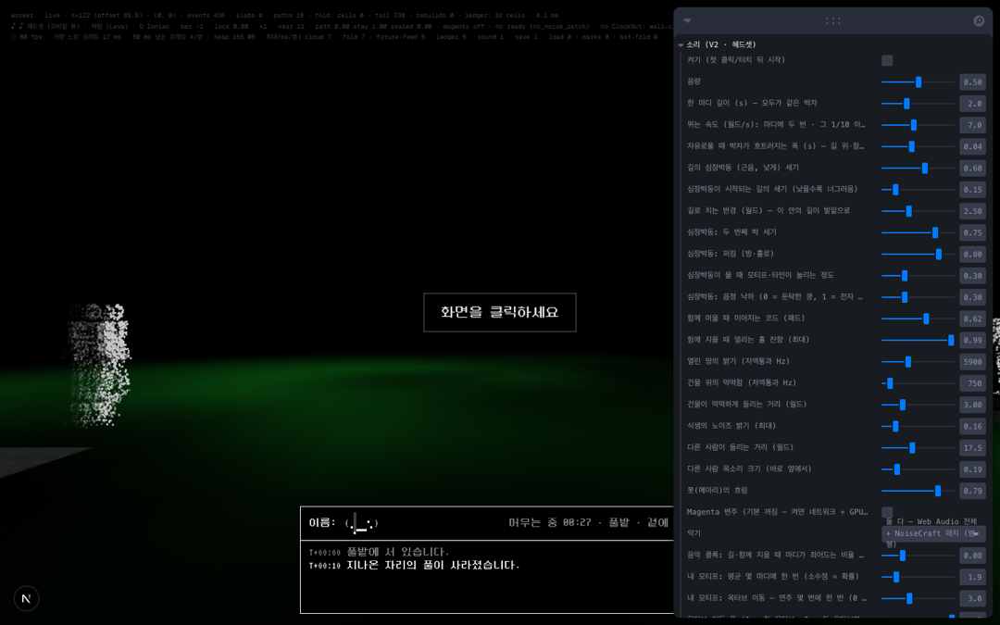

데스크톱 경로(터치 에뮬레이션 없음; `window.__street` people 12 · instances 77 · points 480 · copies 6): 3 m 앞의 몸이 **480점**으로
서고 그 뒤로 **번짐 복사본**이 옅게 늘어선다. 왼쪽 아래 발밑에 **닳은 회색 칸**. 60 fps(헤드리스), 가장 느린 프레임 17 ms — 12명 + 복사본
65개를 그려도 전과 같다.

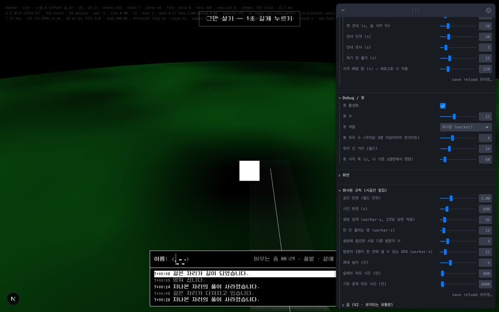

지금 카메라(7 뒤)로 위에서: 내가 걸어온 자리가 흰 길 선 아래 **회색 띠**로 닳고, 띠의 가장자리에 줄눈이 선다. 봇들이 머문 자리는
20 s 뒤 `slabs 7`(건물이 섰다). 풀 면의 바람 결은 정지 화면에서는 안 보인다(영상으로).

**프리뷰에서 사람을 보려면**: 재편 head(e4f7d46)부터 `next dev`·브랜치 프리뷰는 모두 봇 서버의 **"rehearsal" 세계**에 붙는다(전시
세계 "redesign"은 프로덕션만). 리허설 세계에 봇이 돌고 있지 않으면 개인뷰에 아무도 없다 — 같은 프리뷰의 벽(`/v2/global/space`,
패널 있는 창)을 한 번 열어 두면 그 창이 리허설 세계의 봇을 돌린다; 또는 개인뷰 주소에 `?botserver=0`을 붙이고 `Debug / 봇 › 봇 활성화`를
켜면 그 탭 안의 봇 12명이 바로 곁에 선다(공유 세계에는 아무것도 안 감). 헤드리스에서 리허설 세계는 두 번 모두 비어 있었다(events 2).

## 8. 3단계 — 척도 · 다양성 · 걸음 · "나" (2026-11-22 밤)

### 8.1 척도: 1 월드 = 몇 m

봇이 건물 폭(칸 1.2 월드)에 비해 너무 컸다. 세계의 길이들은 한 척도가 아니다 — 칸 1.2, 건물 1–6, 봇 2.2/s, 관객 7/s를 모두 "m"로 읽으면
사람(1.7)이 칸 하나보다 크다. 그래서 **`척도 — 1 월드 = 몇 m`** 노브(기본 2.5)를 두고, 사람과 눈에 관한 길이는 모두 **m로 적고 척도로
나눈다**: 키 1.7 m → 0.68 월드, 눈높이 1.6 m → 0.64, 점 크기 0.07 m, 마주 보는 거리 3 m, 뒤로 1.6 m, 시선 6 m. 칸 1.2 월드 = 3 m, 건물
1–6 월드 = 2.5–15 m. 작가가 나무(식생 점, 높이 ~0.5–0.9 월드)와 건물을 보며 척도 하나로 맞추면 된다.

따라오는 문제: 봇은 서버에서 2.2 월드/s로 걷는다 = 척도 2.5에서 **5.5 m/s(달리기)**. 몸이 그 속도를 다리로 따라가면 허둥댄다. 그래서
**걸음 박자 상한**(기본 2.2 걸음/s)을 두어 다리는 그 위로 빨라지지 않고 몸이 미끄러진다. 근본은 서버의 봇 속도(봇 서버 세션 영역)와 관객
속도 — 관객은 이번에 **2.5 월드/s**로 내렸다(작가 결정; 척도 2.5에서 6 m/s이므로 1–1.5도 시험해 볼 값).

### 8.2 사람마다 다르게

해시로 몸마다: 키 ±8 %, 체격(폭) ±10 %, 걸음(최고 속도·가속) ±15 %, 보폭은 키를 따라, 몸 돌리는 속도 ±20 %. 노브 `사람마다 다르게`(0–1).
GPU(키·체격)와 CPU(보폭·속도)가 같은 해시 함수를 쓴다.

### 8.3 걸음

`jointsAt`를 다듬었다: 골반이 다리와 함께 돌고(±0.13 rad) 어깨는 반대로(±0.09), 체중이 선 다리 쪽으로 2 cm 옮겨 가고, 무릎은 선 다리에서도
완전히 잠기지 않고(0.08 rad), 팔꿈치는 팔이 앞으로 올 때 더 굽고, 발뒤꿈치는 미는 구간(π → 3π/2)에 들리며, 머리는 골반보다 덜 흔들린다.
여전히 사인 골격이다 — 더 가려면 모션캡처 파일(CMU 등)로 `jointsAt`만 바꾸면 되는데, 받기 전에 파일·출처·크기를 적어 작가에게 묻는다.

### 8.4 "나" — 사각형 대신 내 등, 리듬은 몸이 깜박임

작가의 질문: 눈높이가 되면 '나'를 시선 앞 사각형으로 둘 이유가 있나, 그러면 리듬(내 멜로디의 깜박임)은 어떻게 전하나.

만든 답(스위치 `나 = 내 등 (점 몸)`, 기본 끔): 눈 바로 앞 0.64 m에 **내 몸이 다른 사람과 같은 점 몸으로 서고**(내 등·머리가 화면 아래 가운데에
크게, vinils의 걷는 사람처럼), 내가 걸으면 그 몸이 내 속도로 걷는다. **멜로디는 그 몸의 점이 깜박인다** — 내 박자가 울리는 스텝에 밝고,
쉬는 스텝엔 `멜로디가 쉴 때 내 몸의 밝기`(0.4)로 어두워진다. 사각형(`PlayerCursor`)은 그때 숨긴다. 끝이 가까울 때 사각형이 빨라지던
경고 깜박임은 아직 몸에 옮기지 않았다(수명 경고는 `lifeRef.warn`; 다음 단계).

다른 길(안 만듦): 발밑 바닥에 깜박이는 고리 / 화면 가장자리의 희미한 박동(무채색) / 사각형을 발치로 내리기.

### 8.5 확인 (헤드리스, 이 탭의 봇 12명)

- 터치 경로(폰 경로 200점)로 걸으며: `window.__street` people 12 · instances 13 = 12명 + 나. 내 등이 화면 아래 가운데에 서서 내 속도로
  걷고, 멜로디의 쉬는 스텝에 어두워진다(캡처 `d11-walking`, 스크래치). 데스크톱 경로: 480점 + 복사본(instances 60–78).
- 코앞(0.64 m)의 내 몸은 점이 20 px까지 커져 뭉개졌다 → `점 최대 크기 (px)` 상한(기본 6)을 두었다(§9).

## 9. 4단계 — 로그의 자리 · "가까이 가야 안다" (2026-11-22 저녁, 부모 세션 경유)

작가: "로그는 시야각 높이면 왼쪽이나 오른쪽 어딘가… 아래 있으니깐 본능적으로 발밑이 안 보인다는 생각에 뭔가 위태롭네" → "폰에서는 로그가
위쪽에 뜨는 게 맞는 것 같고 랩탑은 왼쪽에 패널처럼 보이는 게 맞는듯". 그리고 "아예 내가 움직이고 가까이 가야지만 알 수 있도록 '현재'에
대한 경험도… 눈에 나타나기 전까지는 로그랑 사운드로만 단서를 받을 수 있도록".

### 9.1 로그의 자리 — `SessionHud` prop `logPlace`

`SessionHud.tsx`에 prop 하나(`logPlace`: bottom · left · top, 기본 bottom = 지금)를 더하고 LIVE 기록 상자의 **바깥 컨테이너 클래스만**
분기했다(안의 마크업·기록 줄·끝 카드는 그대로; 표본 카드 세션에 알림). 노브 `로그의 자리`: **자동**(눈높이면 랩탑 = 왼쪽 세로 패널, 폰 =
위쪽 띠; 아니면 아래) / 아래 / 왼쪽 / 위.

- 왼쪽 패널: 왼쪽 가장자리, 폭 `min(24vw, 22rem)`(화면 1/4 이하), 위 5rem ~ 아래 6rem, **새 줄이 아래**에 쌓이고 오래된 줄은 위로 올라가며
  `mask-image`로 흐려진다. 화면 가운데와 아래(발밑·다가오는 것의 자리)는 비운다.
- 위쪽 띠: 위 3.5rem 아래에, 기록 줄 상자를 4.6rem(2–3줄)로 자르고 **새 줄이 맨 위**(`flex-col-reverse`).

### 9.2 "가까이 가야 안다" — 세 겹

| 겹 | 거리 | 단서 | 어디서 |
|---|---|---|---|
| 멀리 | ~24 월드(`VIEW_RADIUS`) | 소리뿐 — 헤드셋의 타인 멜로디·머리 방향 패닝 | 기존 `personalSignals`(life-recording 영역, 손대지 않음) |
| 중간 | 시야 반경 ~ `말이 닿는 거리`(12) | **방향 말 한 줄** — "왼쪽 어딘가에서 누군가 걷고 있다", "앞에 무언가 서 있다" | `StreetHud.tsx`(새 파일): `witnessRef.far`에서 시야 밖 가장 가까운 이, 시선(yaw) 기준 8방위, `말 사이 간격` 6 s, 7 s 뒤 사라짐. 로그 곁(왼쪽 패널 머리 / 위쪽 띠 아래 / 아래 상자 위). 기록(`witness.ts`)에는 쓰지 않는다 — 시험 |
| 가까이 | `시야 반경`(8 월드) 안 | 눈 — 점 몸 | `시야 반경` 스위치: 안개를 0.45 r ~ r로 바싹 당긴다. 외곽선(`ConcreteOutline`, 원래 `fog false`)도 이때만 안개를 받는다(`streetLook.viewFog`, 재질 한 번 재컴파일). 사람 점·판도 강제로 안개 |

시야 반경은 월드 단위다(척도 2.5면 8 월드 = 20 m). `witness`의 near(3)·far(24)와 같은 단위로 두었다.

### 9.3 확인 (헤드리스, 이 탭의 봇 12명)

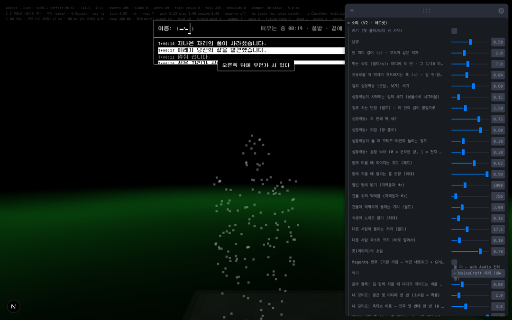

터치 에뮬레이션(= 거친 포인터 → 폰 배치) 1440×900: 로그가 **위쪽 띠**로 올라가 2–3줄만 보이고(새 줄이 위), 그 아래에 **"오른쪽 뒤에 무언가
서 있다"** 한 줄 — 봇 12명 중 가장 가까운 이가 5.4 월드, 시야 반경 8 안에는 없고 12 안에는 있을 때의 말. 시야 반경 8: 풀 면이 8 월드에서 검정으로
가라앉고 그 밖의 사람·외곽선은 안 보인다. 가운데 아래는 내 등(멜로디가 쉬는 스텝이라 어둡게). 60 fps · 17 ms.

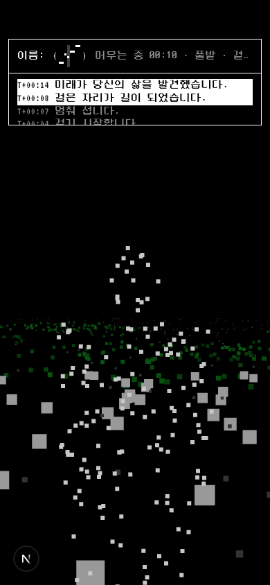

폰 크기(관객 주소 `ui=0`): 위쪽 띠 로그, 아래 절반은 발밑과 다가오는 것의 자리로 비어 있다(흩어진 네모는 future-presence의 "미래가
당신의 삶을 발견했습니다" 점구름).

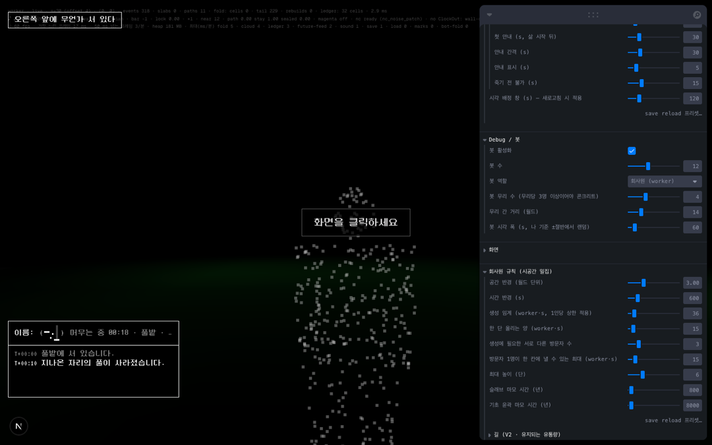

가는 포인터(랩탑·전시 기계) 1440×900: 로그가 **왼쪽 세로 패널**(폭 24vw 이하)로, 새 줄이 아래. 패널 머리에 **"오른쪽 앞에 무언가 서
있다"**. 가운데 시야는 비고, 내 등(480점, 점 6 px 상한이라 뭉개지지 않음)이 아래 가운데. `window.__street` people 12 · instances 70–80.
(왼쪽 위 작은 흰 줄은 개발 판독이라 관객 주소엔 없다.)

## 10. 5단계 — 깜빡이는 상자 속 실루엣 (2026-11-22 밤)

작가의 답: 타인 = **지금의 네모(자기 멜로디로 깜빡이는 상자)를 사람 키로 세우고, 그 안에서 실루엣이 걷는다**. 점을 쓰지 않고, 나는 상자(지금
사각형) 그대로.

- `사람 =` 선택: **깜빡이는 상자 속 실루엣**(기본) / 점 실루엣. `PointPeople.tsx` 안에서 같은 움직임(표본 보간·보폭·마주 보기·다양성)을 쓰고
  그리기만 다르다.
- **상자**: 눈을 향해 서는 빌보드 한 장(인스턴스, 드로우 콜 1). 키 = 척도로 나눈 키 × 사람마다의 배수, 폭 = 키 × 0.55(노브). 멜로디가 치는
  스텝에 흰색, 쉴 때 회색 0.22(옛 네모의 `SQUARE_REST`와 같음).
- **실루엣**: 걷기 사이클 16장을 **스프라이트 시트**(캔버스 48 × 96 px × 16, 옆모습, 팔다리는 굵은 선)로 한 번 그려 두고, 사람의 위상(속도로
  진행)으로 장을 고른다. 상자가 흰 스텝엔 실루엣이 검고, 회색 스텝엔 밝은 회색 — 어느 쪽에서도 읽힌다. 화면에서 왼쪽으로 가면 거울상.
  서면 다리를 모은 장에서 멈춘다. 점 0개.
- **큐**: 누가 내게 말을 걸면(기록의 `word.asked`/`word.new`, RoleField가 소리에 쓰는 것과 같은 줄) 질문이 열린 7 s 동안 그 사람의 상자가 20 %
  커진다(점 몸이면 15 % 커지고 흰색). 노브 `말 거는 이에게 큐`.
- **나**: 상자(사각형) 그대로. `나 = 내 등` 스위치는 점 몸 모드에서만 산다. 눈높이는 기본 켬, **`뒤로` 0 = 1인칭**(작가 결정, 11/22 밤 "1인칭으로").
  내 상자는 발밑에 있어 시선을 내려야 보인다; 내 멜로디는 헤드셋과 로그 머리의 기호가 전한다.
- 시간의 번짐은 상자 모드에선 없음(점 몸 모드에만).

### 10.1 확인 (헤드리스, 이 탭의 봇 12명, 기본값: 눈높이 켬 · 뒤로 3 m)

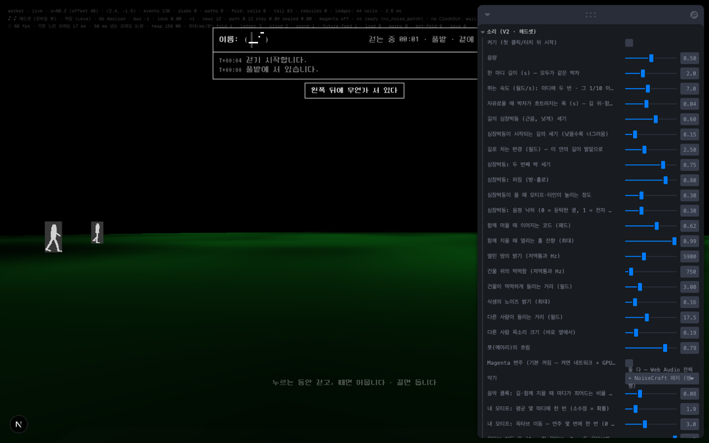

왼쪽에 둘: 멜로디가 치는 스텝의 사람은 **흰 상자 안의 검은 걷는 실루엣**, 쉬는 스텝의 사람은 **어두운 상자 안의 밝은 실루엣**. 상자 12개 =
인스턴스 12, 점 0. 60 fps · 17 ms. 상자의 키는 척도 2.5에서 0.68 월드(사람마다 ±8 %). 위쪽 띠 로그 아래 "왼쪽 뒤에 무언가 서 있다"(시야 밖
방향 말). 큐(말 거는 이의 상자가 커짐)는 봇이 말을 걸 때만 보여 이 캡처엔 없다.

## 11. 6단계 — 흰 바탕 (오가닉) (2026-11-22 밤, 부모 세션 경유; 레퍼런스 43점 스터디 §6·§6.2)

작가: "하는 김에 지금 생각하는 브루털 룩이 **완전 오가닉하게 개편**되어도 좋다." 오가닉 = **장노출의 번짐**(1575–1583) + **종이·아세테이트의
겹침**(1401·1585·1579). 개인뷰만. 선·격자·외곽선·네모의 언어를 버린다.

스위치 `길거리 › 흰 바탕 (오가닉)`(기본 꺼짐). 플래그 = `streetGround.paper`(`streetLook.ts`, 프레임마다 읽는 모듈 값; 바뀌면 `window`에
`street-look` 이벤트) — future-presence가 닥쳐오는 2D 프레임의 판을 이 플래그로 맞춘다(알림 보냄).

| 것 | 흰 바탕에서 | 어디서 |
|---|---|---|
| 바탕·안개 | 종이 `#f4f2ec`. 안개도 종이색 — **멀수록 하얗게 사라짐**. 시야 반경도 같은 흰 안개 | `ParliamentScene` |
| 땅 | 식생 밀도 = **연한 초록 번짐**(`LinearFilter`의 부드러움 그대로), 길이 난 칸 = **눌린 회색 자국**(줄눈 없음, 결은 아주 약하게), 바람 결 유지 | `DitherGround` `uPaper` |
| 길 선 | 없음(눌린 자국이 길) | `PathLines`: 그리지 않음 |
| 건물 | 외곽선 대신 **회색 번짐 덩어리** — 칸마다 부드러운 점 하나(높으면 둘, 크기 2.2 칸)가 겹쳐 덩어리로 | `Marks.tsx ConcreteOutline` 안의 둘째 렌더러 |
| 네모 점 풀 | 연한 초록 | `NatureCloud` |
| 사람 | **흰 위의 검은 얼룩**: 실루엣 시트를 가장자리 번짐(`blur` 3 px)으로 한 장 더 구워 씀. 서면 번진 얼룩, 걸으면 화면 방향으로 **늘어남**(속도 × 0.4)과 **꼬리**(지난 자리의 옅은 얼룩, 번짐 2.5 s). **가까울수록 진하고 멀수록 옅음**(`멀수록 옅어지는 거리` 12 월드). 상자는 **희미한 연필 테두리**(멜로디 스텝에 조금 진해짐). `개체 라벨` 거리(4 월드) 안의 셋에 **개체 번호 + 지시선**(작은 글씨, `hud-ko`) | `PointPeople` 상자 모드의 종이 분기 |
| 점 몸 모드 | 점이 검정(0.08) | `PointPeople` |
| 로그 | 모양·자리 그대로, 삶이 흐르는 동안 **색만 반전**(검은 상자·흰 글 → 흰 상자·검은 글); 안내·끝 화면은 그대로 | `ParliamentScene`의 래퍼(`filter: invert(1)`) — SessionHud 안 건드림 |
| 내 상자 | 발밑의 흰 네모는 종이 위에서 안 보임(1인칭이라 어차피 시선 밖). 검게 바꾸려면 `PlayerCursor`(mobile/scene)를 손봐야 함 — 미정 | — |

### 11.1 확인 (헤드리스, 이 탭의 봇 12명, 1인칭)

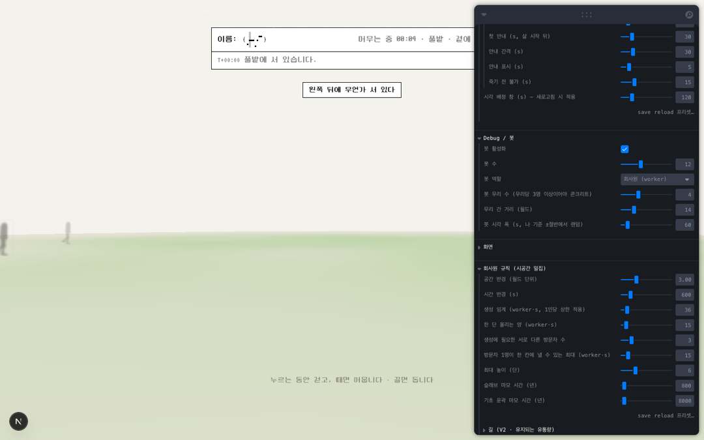

종이 위: 연한 초록 땅이 멀수록 하얗게 사라지고, 왼쪽에 **회색 얼룩 둘**(가까운 쪽이 진하고 희미한 연필 테두리, 먼 쪽은 옅음), 로그는 흰 상자·검은 글,
그 아래 "왼쪽 뒤에 무언가 서 있다". 상자 12개, 60 fps · 17 ms.

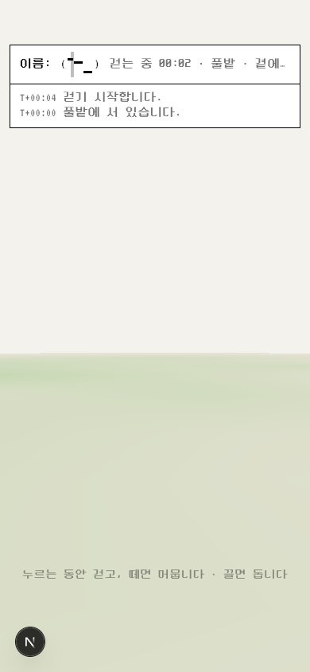

폰 관객 주소: 위쪽 띠 로그가 종이에 맞춰 검은 글, 아래는 연한 초록 땅. (건물 덩어리와 개체 라벨은 이 자리에 건물·4 월드 안의 사람이 없어 캡처에
없다 — 코드 경로만.) `paperLook.ts`는 future-presence와 글자 그대로 같은 파일로 두 브랜치에 각각 추가(add/add, 충돌 없음); 이 세션이 쓰고 그쪽은 읽는다.

## 12. 7단계 — 각자의 창 · 의도적 플리커링 · 말 걸기 버블 (2026-11-22 밤, 부모 세션 경유; 스터디 §6.3.2)

작가: "각자의 윈도우가 있고 그게 늘어져서 이동이 보이는… 사라지면서 꼬리를 남기고. 어차피 지금 서버에서 받아오는 간격도 좀 긴 걸로 아는데?" /
"사람 각자도 움직이는 얼룩, 걸음도 의도적 플리커링(디바운스랑 정렬해서)" / "타인이 말 걸면 그 사람 옆에 TD 버블/블롭처럼 사각형 테두리랑 멜로디".

흰 바탕 안의 노브(`PointPeople` 상자 모드):

| 노브 | 기본 | 뜻 |
|---|---|---|
| 의도적 플리커링 | 켬 | 보간 없음. 서버 표본(≈0.5 s)이 오면 몸이 **그 자리에 그냥 있고**, 보폭 한 걸음만큼 위상이 넘어가며 이동 방향을 본다. 그 사이엔 선다 |
| 창이 이동만큼 늘어남 | ×1 | 표본 사이의 변위를 화면 가로로 투영한 만큼 **창이 늘어나고**(옛 자리 → 새 자리를 덮음) 다음 표본까지 줄어든다 — 늘어난 창이 곧 이동의 그림. **사라질 때**는 줄지 않고 1.6배로 늘어난 채 옅어진다(꼬리) |
| 떨림 | 2 cm | 표본이 온 직후 0.14 s 동안 창이 화면 가로로 떤다 |
| 번짐 반경 | 8 월드 | 이 안의 사람만 여기서 얼룩으로; 밖은 1.5 월드에 걸쳐 사라지고 **future-presence의 현재 스캔**(밝은 점 덩어리)이 맡는다. 시야 반경을 켜면 그 값. 공유 플래그 `paperLook.near` |
| 버블 | 켬 | 말을 거는 사람(기록 `word.asked`/`word.new`) 옆에 **사각 테두리 + 그의 멜로디 기호(`Glyph live`)** 가 마디에 맞춰 깜박이며 뜬다(`hud-blink`); 응답(`word.answered`)이나 7 s 뒤 닫힘. 그 동안 창도 20 % 크다 |

`paperLook.ts`(두 브랜치에 글자 그대로 같은 파일)에 `near` 필드를 더했다: `{ on, paper, ink, near }`.

작가의 추가 답(같은 밤): 창의 비율은 고정이 아니라 **봇마다 씨앗으로**(노브 `창 비율 최소/최대`, 기본 폭/키 0.5–1.3) + 이동만큼 늘어남; **나는 1인칭
그대로**, 내 창은 없고 발밑의 흰 사각형은 종이에서 숨김(`hideCursor`); "이터레이션을 많이 돌려봐야 알 것 같다" → 얼룩·창·플리커·꼬리는 모두 노브
(`꼬리가 남는 시간` 추가).

### 12.1 확인 (헤드리스, 이 탭의 봇 12명, 번짐 반경 14로 넓혀서)

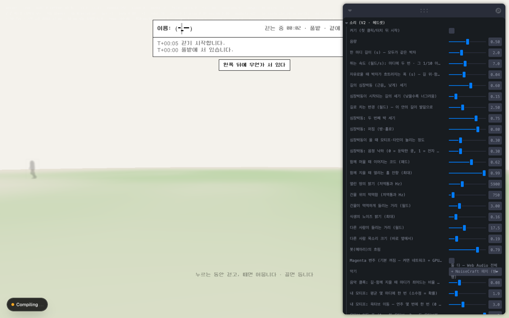

왼쪽에 서 있는 한 사람: 회색 얼룩 몸과 희미한 창. 서 있어서 창은 늘지 않았다(늘어남·떨림·꼬리는 영상으로 봐야 함 — 프리뷰에서). 상자 12개,
60 fps. 버블은 봇이 말을 걸 때만.

## 13. 8단계 — 다양성 · 겹침 · TD 창 · 멜로디 이름 · 말 걸기의 효과 (2026-11-22 밤)

작가(프리뷰를 본 뒤): "사람들이 좀 더 다양해야 할 것 같아. 겹친 부분은 확 더 진하게. TD 블롭 느낌 내려면 사각형 테두리도 더 샤프하고 동적으로.
이름은 봇_숫자가 아니라 멜로디 음형. 말 걸 때 효과 확 느껴지도록 … 보는 각도는 어떻게 바꿀지. 걷거나 하는 제스처도 훨씬 더 다양해야.
말 걸 때도 지금 걷는 거랑 동작이 같으니 와닿지 않아."

| 것 | 만든 것 | 노브 |
|---|---|---|
| 제스처 다양성 | 걷는 법 **4종**(`WALK_STYLES`: 보통 / 급하게 기울여 성큼 / 짧고 조용히 팔은 가만 / 팔을 크게 흔드는 느슨한 걸음)을 스프라이트 시트 네 줄로 굽고, 봇마다 씨앗으로 한 줄. 여기에 진하기 ±20 %, 가장자리 번짐(선명↔번짐 섞기), 창의 기울기 ±4°가 제각각 | `사람 다양성` 0–1 |
| 겹치면 진하게 | 종이에서 창 재질을 **곱하기 블렌딩**으로: 얼룩이 겹치면 곱해져 확 어두워진다 | `겹치면 확 진하게` |
| TD 창 | 흐린 연필 선 대신 **크리스프한 모서리 브래킷**(변의 20 %) + 머리카락 테두리. 박자에 굵어지고, 말 거는 이는 더 굵게. 표본마다 떨림·늘어남은 그대로 | `창 테두리 세기` |
| 이름 | 라벨의 "개체 0417" → **멜로디 음형(`Glyph live`)** + 지시선 | `개체 라벨` 거리 |
| 말 걸 때 | 그 사람은 걷기 대신 **손을 드는 동작**(시트 다섯째 줄 `WAVE_STYLE`: 서서 한 팔을 들어 흔듦, 제 박자로); 창 35 % 크게, 브래킷 굵게; **사각 파문** 둘이 창에서 1 s 주기로 퍼지며 옅어짐; **시선**이 1.2 s 동안 그쪽으로 부드럽게 돈다(마우스·드래그로 돌리는 중이면 양보). 버블(테두리 + 멜로디 기호)은 그대로 | `말 걸면 시선이 돌아감`, `말 걸면 창에서 사각 파문` |

시선 전달은 `streetLook.ts streetGaze`(PointPeople가 쓰고 ParliamentScene의 Controller가 읽음). 응답 뒤(`word.answered`) 모두 걷기로 돌아간다.

### 13.1 확인

_캡처 뒤 채움._
